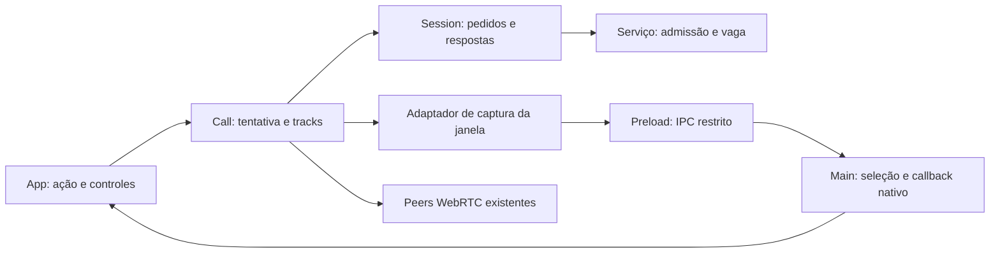

# Captura de mídia e saída da chamada Design

**Spec**: [spec.md](spec.md). **Status**: Draft para revisão conjunta com [tasks.md](tasks.md). **Base inspecionada**: `cd53044`, código inalterado desde `58be3ed`. O pedido que originou o planejamento autorizou gerar os dois documentos sem iniciar implementação. Os 34 resultados MEDIA permanecem sem certificação.

**Nota de 2026-10-25:** a autorização posterior C7 da spec determina revisão documental e depois estabilização pela sessão nova. Nesta revisão nenhuma tarefa foi executada. As escolhas técnicas deste Draft, inclusive protocolo v2 e bridge síncrona de captura, continuam propostas que exigem reconciliação antes da alteração correspondente. Autorização geral de continuidade não é confirmação silenciosa dessas escolhas. Preservar os prazos e critérios da spec.

## Architecture Overview

Recomendação: manter `Call`, `Session`, host Electron e serviço existentes. Acrescentar identidade imutável de tentativa, correlação da seleção nativa e liberação com prazo nos pontos que já possuem os recursos. Não adicionar biblioteca de estados, serviço de mídia, SFU ou persistência de sessões de chamada.

O compartilhamento já está implementado: `shareScreen` captura e publica, `stopScreen` encerra a tela, e o host Electron enumera fontes e resolve a seleção. Este design estabiliza esses caminhos. A investigação de câmera no Discord documenta uma referência; não adiciona câmera ao Conversa nem remove sua negação atual.

### Abordagens consideradas

| Abordagem | Benefício | Custo e limite | Recomendação |
| --- | --- | --- | --- |
| A. Reforçar os proprietários atuais | Preserva malha WebRTC, APIs e testes; mudanças seguem o recurso que precisa terminar. | Exige explicitar os contratos entre renderer, main e servidor. | Recomendada para este recorte. |
| B. Centralizar tudo em um coordenador novo | Um ponto para comandar transições. | Move responsabilidades de quatro componentes e cria uma segunda fonte de estado durante a migração. Os contratos distribuídos continuam necessários. | Não adotar nesta estabilização. |
| C. Modelar os mesmos fluxos com biblioteca de máquina de estados | Transições declarativas. | Introduz dependência e migração sem resolver sozinha callbacks nativos, senders ou ordenação no servidor. | Não adotar nesta estabilização. |

A é a escolha técnica proposta neste Draft, não uma nova decisão arquitetural já confirmada pelo usuário. A elaboração conjunta das tarefas detalha essa recomendação para revisão; não representa aprovação para Execute. C1/C2 e os resultados da spec não mudam entre as alternativas.

### Fronteiras de autoridade

- `Call` possui microfone, streams provisórios, tela e peers. Apenas a tentativa vigente publica ou altera seu estado.
- O adaptador da janela possui a chamada pendente a `getDisplayMedia`, inclusive entre instâncias de `Call`. Ele não deixa um pedido nativo antigo ser associado à tentativa nova.
- O host possui o callback nativo, o inventário e seu prazo de 60 s. Resolver o callback não é prova de que as tracks retornadas ao renderer foram encerradas; essa parte pertence a `Call`.
- `Session` possui conexão, contexto de sala e pedidos correlacionados. O serviço possui admissão e vaga. Limpeza local não espera confirmação remota.
- A reprodução deriva do controlador atual admitido, conexão vigente e opção “Silenciar áudio”. Referências antigas não podem habilitá-la.

## Code Reuse Analysis

| Componente existente | Localização | Reuso e alteração delimitada |
| --- | --- | --- |
| Controlador de chamada | `src/rtc.js:30`, `:54`, `:176`, `:200`, `:210` | Manter aquisição exclusiva, gerações, slots de áudio/vídeo e timers; tornar os contextos imutáveis e separar tela provisória de tela publicada. |
| Sessão | `src/session.js:106`, `:130` | Manter `pending`, `epoch`, `roomContext` e timeout; validar também geração e revisão de presença antes de aplicar resultado. |
| Captura nativa | `electron/main.js:51`, `:57`, `:76` | Manter `settleCapture`, remoção antes do callback e inventário assíncrono; vincular pedido ao documento e à operação preparada. |
| Política/preload | `electron/policy.js:9`, `:17`, `:20`; `electron/preload.cjs` | Reusar validação do frame real e origem normalizada. Expor apenas operações de captura delimitadas, sem expor IPC ou MediaStream pelo bridge. |
| Participante no serviço | `server/service.js:77`, `:105`, `:137`, `:153` | Manter cotas separadas e isenção terminal; adicionar marca terminal por geração e expiração exata do heartbeat. |
| Contrato compartilhado | `shared/protocol.js` | Reusar IDs limitados a 128, inteiros seguros, categorias de erro e versão anunciada por `/api/config`. |
| Interface | `src/main.jsx:79`, `:87`, `:118`, `:147` | Manter layout, modal e controles; adaptar correlação, estados pendentes e diagnóstico. |
| Verificação | `tests/rtc.test.js`, `tests/service.test.js`, `tests/session.test.js`, `scripts/desktop-capture-check.mjs`, `scripts/desktop-smoke.mjs` | Reusar dublês, transporte real, fixture Electron e inventário de callbacks; acrescentar somente resultados ainda sem evidência adequada. |
| Harness e pacote | `scripts/test-runtime.mjs`, `scripts/check-package.mjs`, `scripts/portable-startup-check.mjs` | Preservar perfis temporários, teardown limitado, manifesto/hash e abertura do portátil real. |

Não há migração SQLite. Estado de chamada, seleção, geração e revisão vivem somente durante a conexão/documento que os possui.

## Components

### 1. Tentativa e microfone em Call

**Location**: `src/rtc.js`. **Reuses**: `join`, `acquireMicrophone`, `leave`, `close`, `current`, `deadline`.

Cada entrada cria um objeto de contexto com `callId`, `generation` e estado. Os identificadores são imutáveis; cancelar torna aquele objeto terminal e a guarda compara sua identidade com a tentativa atual. O terminal sempre envia a geração capturada, sem incrementar ou buscar um `callId` mutável depois de um `await`.

A geração é alocada pela Session da conexão, por `nextCallGeneration(epoch)`. Trocar a instância de Call na mesma conexão não reinicia o contador; outra conexão pode reiniciá-lo porque o domínio servidor também é novo. A operação com epoch antigo é recusada antes de pedir mídia. Call recebe a função alocadora por dependência, com padrão local para seus testes isolados.

Estados: `idle → acquiring → admitting → admitted → terminal`; microfone negado passa de `acquiring` para `admitting` em escuta. Uma nova entrada cria outro contexto. `close` impede novas aquisições naquela instância.

Interfaces propostas, preservando os métodos existentes: `join(): Promise<void>`, `leave(): Promise<void>`, `close(): void`, `toggleMicrophone(): Promise<void>`. `leave` invalida o contexto, encerra tracks e fecha peers antes de devolver a promessa da notificação. `close` cancela recursos mesmo se a rede já terminou. Microfone provisório nunca chega aos senders antes do ack da admissão vigente.

Todo stream adquirido fica num registro local até ser incorporado ou encerrado. A resolução antiga encerra suas próprias tracks; não limpa o campo da captura nova. Mute altera a transmissão do microfone e pode manter a track live; saída exige ended. Erros carregam código, fase e contexto opaco, sem mídia. O clock real de Call passa a usar `performance.now()` para instantes relativos, mantendo a interface de clock injetável existente.

### 2. Transação de tela em Call

**Location**: `src/rtc.js`. **Interfaces propostas**: `shareScreen(systemAudio, quality)`, `stopScreen()` e dependências `captureDisplay(key, constraints)` / `cancelDisplay(key)` fornecidas pelo App; padrão sem Electron usa `navigator.mediaDevices` existente.

Estados: `idle → selecting → publishing → active → stopping → idle`. Cada operação tem `operationId` próprio. `display` publicado não representa a captura provisória: a UI recebe também `sharingState`. `active` só ocorre depois de publicar nos peers elegíveis e receber confirmação do estado. Sem outros peers, a confirmação do serviço basta; não se inventa mídia remota pronta.

O prazo de publicação é absoluto: captura obtida + 8 s, incluindo sua confirmação. Uma falha invalida a operação antes de compensar. Todas as tracks da tela são paradas imediatamente; remoção de senders não adia esse stop. O controle local converge em até 1 s e a notificação terminal possui o prazo separado da spec.

Usar as filas dos peers para ordenar mutações de tracks, incluindo `attachTracks`, início, parada e peer que entrou durante a transmissão. Cada closure captura contexto, operação e identidade do peer, validando-os antes e depois de esperas. O helper que aplica tracks dentro da fila não volta a enfileirar a própria execução.

O registro da operação inclui todos os peers que receberam ou podem receber sua captura, não apenas os presentes no momento do primeiro `Promise.all`. Uma remoção rejeitada ou suspensa fecha apenas o peer que não pode cessar o envio em 1 s. Peers saudáveis mantêm o microfone anterior. Resoluções tardias não anexam tracks live nem anunciam `sharing=true` para uma operação terminal. O inventário exige tracks ended e sender sem essa captura ou peer fechado.

Paradas repetidas compartilham a limpeza em andamento e seu prazo original. Cada remoção recebe o saldo de `terminalAt + 1000 - now`, não um novo segundo por peer ou repetição. `onended`, saída e erro técnico usam a mesma finalização idempotente.

### 3. Seleção nativa e adaptador da janela

**Locations**: host em `electron/main.js`; bridge em `electron/preload.cjs`; validação em `electron/policy.js`; adaptador mínimo em `src/main.jsx`.

O request nativo do Electron informa frame, origem e modalidades; não oferece nossa chave de operação. Por isso haverá no máximo uma aquisição nativa de tela ainda não assentada por documento. A guarda fica na janela, sobrevivendo à substituição de `Call` durante saída/reentrada.

O host renova um token opaco por documento em `did-start-loading`. O preload o obtém uma vez por IPC síncrono restrito ao frame local e o mantém em closure, acrescentando-o a cada mensagem de captura e filtrando eventos recebidos. O token não fica como argumento fornecido pelo App. Um IPC atrasado do preload anterior não pode preparar, cancelar ou finalizar a seleção do documento novo, mesmo se o webContents mantiver o mesmo ID.

API estreita proposta no preload:

| Operação | Contrato |
| --- | --- |
| `prepareCapture(key)` | Registro síncrono validado e limitado a memória. Aceita duplicata da mesma chave; recusa outra chave enquanto a aquisição anterior não terminou. |
| `cancelCapture(key)` | Cancela somente a chave exata, mesmo antes de o inventário ou o callback nativo estarem disponíveis. |
| `finishCapture(key)` | Devolve resultado terminal estruturado e libera a guarda depois de a promessa real de `getDisplayMedia` assentar, ou se ela nem chegou a ser invocada. Registro síncrono, sem I/O. |
| `onCaptureSources` / `onCaptureError` | Eventos existentes passam também a devolver a chave completa, além de `requestId`. |
| `selectCapture(key, requestId, sourceId)` | Seleção só vale para chave, pedido, documento e fonte correspondentes; `null` cancela. |

O adaptador registra a chave, invoca `getDisplayMedia` no mesmo handler de gesto e mantém a guarda até `finally`. Não faz `await` antes da API de captura. A preparação síncrona não enumera fontes, lê disco ou espera promises. Esse uso delimitado precisa provar `request.userGesture` no Electron 45 e ausência de bloqueio por inventário suspenso.

Sequência: preparar chave → chamada real a `getDisplayMedia` → host associa o único pedido ao registro/frame → inventário assíncrono → evento com chave → seleção validada → `settleCapture` → promessa do navegador assenta → `finishCapture`. O prazo de 60 s começa na preparação recebida pelo host, incluindo inventário.

Se cancelar antes do handler nativo, a chave permanece marcada terminal até aquele handler negar o pedido ou o renderer confirmar que a API não foi invocada. Não se substitui essa chave por uma nova que capturaria o callback antigo. Enquanto a aquisição anterior assenta, nova seleção é recusada como operação pendente recuperável; entrada/saída e voz continuam disponíveis. O teste deve comprovar o assentamento após callback de cancelamento, sem uma espera indefinida escondida no harness.

`settleCapture` remove callback/timer do mapa antes de invocá-lo. Cancelamento usa `null`, já verificado no BUILD e documentado pelo Electron. A guarda da janela só termina na conclusão acima. Inventário tardio verifica se pedido, chave e token do documento ainda estão vigentes antes de enviar qualquer evento. Recarga/fechamento também invalidam o documento; request de frame navegado/destruído é negado, nunca ligado ao registro novo. Um segundo handler nativo para a mesma chave é negado sem substituir ou finalizar o callback do primeiro.

A guarda conserva um único resultado terminal `{ outcome, code, phase, requestId }` até `finishCapture`: escolha, cancelamento voluntário ou falha técnica. Timeout usa `TIMEOUT`; inventário falho usa `MEDIA_FAILED`; fonte inválida usa `INVALID_EVENT`. Assim, um AbortError nativo não apaga a diferença entre cancelamento e erro. O adaptador obtém esse resultado ao finalizar e é o único caminho de relato da operação ao Call; eventos de erro apenas atualizam o seletor correlacionado. A ordem entre evento IPC e rejeição da promessa não causa perda nem duplicação do relato. Erro do navegador após uma concessão é falha técnica, não cancelamento voluntário.

Sem chave preparada, o pedido é negado. A política de câmera, origem, frame e remetente permanece restrita. O bridge não transfere MediaStream; a aquisição continua no renderer. A correlação não autentica uma conta nem substitui autorização de grupos.

### 4. Estado terminal e presença no serviço

**Location**: `server/service.js`. **Reuses**: participante por WS, `endCall`, ack, presença, isenção terminal e `createService`.

Guardar por conexão apenas a maior geração conhecida, seu `callId` e estado `admitted`/`terminal`. Não manter lista crescente de tentativas canceladas. Nova conexão começa outro domínio de geração.

| Entrada | Resultado |
| --- | --- |
| `call-join` com geração maior, sem chamada ativa | Admite se houver vaga e cota; guarda contexto. |
| `call-join` duplicado da tentativa admitida | Mesmo ack; nenhuma vaga adicional. |
| `call-join` antigo ou de geração terminal | `INVALID_EVENT`; nenhuma admissão ou presença reativada. |
| `call-leave` de geração maior ainda não admitida | Registra o terminal antes de qualquer admissão atrasada; retira eventual estado anterior da própria conexão. |
| `call-leave` da tentativa vigente | Marca terminal, libera vaga e tela, confirma o contexto solicitado. |
| `call-leave` de geração anterior | Ack terminal daquela solicitação, sem tocar na chamada nova. |
| Mesma geração com outro `callId` | `INVALID_EVENT`, sem mutação. |

Validação de estrutura/contexto ocorre antes da mutação. Saída válida e `sharing=false` válido continuam fora da cota. Os demais limites não mudam. `media` e `signal` carregam a geração; pedido de tentativa antiga é recusado. Publicações locais usam o controle de operação de tela e a ordem do WS; não se cria um protocolo adicional de transação de mídia.

Cada sala possui um contador de revisão de presença, incrementado quando uma nova fotografia é emitida. O mapa é limitado às salas existentes, teto 100. `Session` aplica somente revisão crescente no contexto de sala atual. Isso impede que uma fotografia antiga reponha chamada/tela após um estado terminal observado.

Heartbeat: manter ping periódico, mas criar uma expiração por cliente em `lastPong + 60000`, usando relógio monotônico. Pong rearma a mesma expiração. Ao expirar, conferir o instante atual e finalizar uma única vez. Close e shutdown limpam a expiração. `createService` recebe um clock de teste no padrão já usado em `Call`; o padrão usa `performance.now()` e timers reais. Não se promete execução de JavaScript enquanto o processo está suspenso pelo SO; os gates medem o prazo no processo ativo, inclusive pong deslocado do tick.

### 5. Contrato compartilhado e Session

**Locations**: `shared/protocol.js`, `src/session.js`. **Decisão proposta**: protocolo 2 para o contrato final, por tornar obrigatória a geração nos terminais e a revisão nas presenças. `/api/config` anuncia a versão; a comparação existente da Session recusa versão diferente antes da aquisição de mídia. Não introduzir negociação de capacidades ou suporte permanente a dois protocolos.

| Mensagem final | Campos adicionais/validação |
| --- | --- |
| `call-join`, `call-leave`, `media`, `signal` do cliente | `generation`: inteiro seguro positivo; `callId` opaco de 1–128 unidades, ligado à geração. |
| `ack` | `generation` da operação respondida; contexto e ação devem corresponder ao pedido pendente. Ack antigo nunca descreve como terminal a chamada nova. |
| `presence` | `revision`: inteiro seguro positivo, crescente por sala; `context` e `members[].generation` existentes continuam validados. |
| Erros | Categorias existentes; `requestId`/fase preservados. Falha sem pedido disponível informa correlação nula. |

Não alterar mensagens, banco ou limites de conteúdo. `signal` recebido continua dirigido por `callId` destinatário e `fromCallId`; a geração de origem é validada no serviço. A atualização das fixtures de serialização deve preservar todas as asserções de resultado e testar explicitamente a rejeição de v1 no contrato final.

Para manter os commits intermediários executáveis, primeiro os produtores enviam os campos aditivos, o serviço os emite e Session os confere quando presentes. O caminho antigo de saída da chamada já admitida pode permanecer somente durante essa sequência local. T6 ativa v2 e remove essa tolerância. Nenhuma versão intermediária é candidata à aprovação MEDIA ou à distribuição. Não há flags, módulo de compatibilidade ou duplicação permanente de parsers.

`Session.request` captura epoch, contexto de sala e tentativa. A Session também aloca gerações monotônicas por epoch de conexão; App fornece essa função ao criar Call. A ligação mínima do produtor acompanha T3, antes da ativação v2 em T6; T7 integra os controles preservando essa ligação. Cancelar entrada invalida e rejeita os pedidos daquela tentativa; ack/error antigo é consumido sem afetar a atual. Revisão de presença reinicia apenas com mudança de conexão/contexto, não com cada render. O timeout terminal continua encerrando transporte caso a confirmação não venha; a liberação local já ocorreu.

### 6. App, reprodução e diagnóstico

**Location**: `src/main.jsx`. Manter uma referência síncrona da operação de seleção, além do estado React. Eventos do host só abrem/fecham o seletor se chave, pedido e tentativa vigente coincidirem. Erro de operação antiga não fecha o seletor novo nem apresenta toast como erro da chamada atual.

`leaveCall`, troca de sala e desconexão primeiro tornam a tentativa terminal, cancelam a seleção e bloqueiam reprodução; confirmação remota vem depois. O efeito de reprodução consulta também o controlador atual, evitando habilitação por um render anterior. A recarga mantém o bloqueio nativo já existente. O botão de saída continua acionável durante seleção/publicação; o estado de tela distingue escolhendo, publicando e compartilhando. Os rótulos e a ordem visual permanecem familiares.

Diagnóstico usa lista de campos permitidos: código, fase, requestId/operationId/callId opacos, geração, versão, runtime e nome técnico da causa. Não serializar objetos de erro, constraints, fontes, SDP, ICE, dispositivo ou conteúdo de mensagens. Cancelamento deliberado não vira falha genérica. A função do App e `logFailure` existentes são os pontos de integração; não criar plataforma de logging.

## Data Models

| Modelo efêmero | Campos e propriedade |
| --- | --- |
| `CallAttempt` | `{ callId, generation, state }`; criado por Call com geração alocada pela Session, capturado por operação assíncrona, nunca reutilizado para reentrada. |
| `ScreenOperation` | `{ operationId, attempt, state, acquiredAt, stream, affectedPeers, cleanupPromise }`; Call possui stream e compensação. |
| `CaptureKey` | `{ callId, generation, operationId }`; três valores imutáveis, IDs 1–128, geração segura positiva. Não é credencial. |
| `NativeSelection` | `{ key, documentToken, frame, contentsId, state, requestId?, callback?, sources, timer, outcome? }`; no máximo um registro por documento até assentamento. Callbacks resolvidos saem do mapa; resultado técnico fica até finish. |
| Estado de participante | `{ highestGeneration, lastCallId, state, lastPong, expiryTimer }` mais dados existentes; um registro por WS, descartado ao fechar. |
| Presença | `{ context, room, revision, members }`; revisão monotônica em memória; cliente descarta fotografias antigas. |

## Error Handling Strategy

| Cenário | Resposta local/remota | Evidência exigida |
| --- | --- | --- |
| Microfone recusado | Escuta permitida; sem nova permissão automática. | Nenhuma track de mic; admissão e tela ainda funcionam. |
| Recusa/timeout de admissão | Terminal local e notificação de saída com contexto capturado. | Todas as tracks ended; geração antiga não ocupa vaga depois. |
| Cancelamento nativo | Callback `null` uma vez; operação cancelada, sem toast técnico. | Contagem/resultados e nenhuma entrega tardia. |
| Inventário falho | `MEDIA_FAILED`, terminal sem captura. | UI reutilizável e ausência de conteúdo nos logs. |
| Fonte inválida | `INVALID_EVENT`, terminal sem conceder recurso, conforme o contrato da seleção acima. | Nenhuma fonte alheia ao pedido é capturada. |
| Publicação parcial | Para tracks, compensa todos os peers atingidos e preserva voz saudável. | Resolução tardia também não restaura envio. |
| Falha/timeout de notificação terminal | Limpeza local mantida; Session encerra transporte conforme o timeout existente. | Vaga remota segue A4 e reprodução não volta. |
| Pacote/contrato incompatível | Recusa por versão antes da chamada. | Nenhuma aquisição; mensagem acionável. |
| Ensaio físico ausente/falho | MEDIA-33/34 não verificados. | Nenhum PASS integral da feature ou cura universal do ruído. |

## Risks & Concerns

Observações por inspeção em `cd53044`; caminhos ainda não reproduzidos nesta entrega não são declarados novos defeitos confirmados.

| Concern | Location (file:line) | Impact | Mitigation |
| --- | --- | --- | --- |
| Identidade lida de estado mutável e limpeza com contador já avançado | `src/rtc.js:18`, `:210` | Resposta/terminal pode ser associado ao contexto errado durante reentrada. | Contexto imutável e teste com ack antigo; T1/T3. |
| Tela exposta antes de concluir publicação; caminhos de attach concorrentes | `src/rtc.js:109`, `:183`, `:200` | UI e senders podem divergir, especialmente com peer tardio. | Operação de tela, fila ordenada e compensação por inventário; T4. |
| Inventário e erro não carregam tentativa de chamada | `electron/main.js:63`, `:68`, `:72`; `src/main.jsx:97` | Seletor antigo pode afetar a reentrada. | Chave preparada, aquisição única por documento e eventos correlacionados; T5/T7. |
| Callback nativo não contém chave de aplicação | `electron/main.js:57` e contrato Electron | Duas aquisições sobrepostas são ambíguas. | Guarda até a promessa real assentar; nunca reatribuir callback antigo; T5. |
| Saída sem geração explícita não registra cancelamento anterior à admissão | `shared/protocol.js:55`; `server/service.js:137` | Admissão atrasada pode ocupar vaga. | Marca terminal por geração, com contrato final v2; T1/T2/T6. |
| Presença não tem revisão | `src/session.js:153`; `server/service.js:74` | Fotografia atrasada pode regredir os indicadores. | Revisão por sala/contexto e teste de reordenação; T2/T3/T6. |
| Heartbeat depende de ticks de 30 s | `server/service.js:153`; `tests/service.test.js:114` | Teste alinhado em zero não demonstra limite a partir de qualquer pong. | Expiração por cliente, relógio monotônico e fronteiras deslocadas; T2. |
| Mute e som físico são evidências distintas | `src/main.jsx:104`; `scripts/startup-audio-check.mjs:15` | Smoke de seis segundos não satisfaz três ciclos físicos de 30 s. | Manter smoke e acrescentar relatório físico A7; T9. |
| Deriva de contrato durante commits | `shared/protocol.js:1`; fixtures v1 | Um bump isolado quebra produtores/consumidores e os testes. | Campos aditivos primeiro, ativação v2 só em T6, gates entre passos; sem release intermediária. |
| Renderer histórico sem vínculo à versão ativa; controles de captura indisponíveis | Spec D1–D11/U1 e relatório de investigação | Atribuir a causa dos botões ao gate encontrado, confundir fluxo estático com captura ou aplicar Browser ao desktop por dedução. | Conservar a causa como hipótese, separar UI de recursos e correlacionar fontes antes da comparação; T8/T9. |

## Tech Decisions

| Decisão proposta | Escolha | Razão e limite |
| --- | --- | --- |
| Estrutura | Abordagem A, componentes atuais e objetos de operação locais. | Ataca ownership sem reorganização geral. |
| Terminal distribuído | Maior geração e último contexto por WS. | Fecha cancelamento anterior à admissão com memória limitada. |
| Presença | Uma revisão por sala/contexto. | Fotografia antiga não sobrescreve estado novo; não cria event store. |
| Aquisição nativa | Chave preparada e uma aquisição por documento até assentamento. | O callback nativo não identifica nossa operação. |
| Preparação IPC | Síncrona e limitada a memória; inventário assíncrono. | Preserva chamada a getDisplayMedia no gesto; não expõe IPC genérico. |
| Compatibilidade final | Protocolo 2, sem suporte permanente a v1. | Novos campos obrigatórios mudam o contrato; rejeitar mistura antes de capturar. A referência STAB/A14 v1 permanece histórica e precisa de reconciliação ao aprovar a mudança, sem certificar os 68 STAB. |
| Validação | Automatizada por AC e ensaio físico A7 separados. | BUILD, RTP e tela decodificada não demonstram qualidade sonora real. |

Nenhuma decisão deste Draft foi promovida ao log de Decisions. Uma alteração futura do recorte ou dos prazos exige revisão da spec, não ajuste de teste para caber no código.

## Validation Strategy and Research

Os testes de cada proprietário acompanham sua alteração. Evidência integrada em T8 identifica versão/hash, AC, asserção e resultado; T9 registra os três ciclos de 30 s e sessão física de 10 minutos. O Verifier fresco encerra a execução depois da última tarefa, com sensor em scratch isolado e gate `validate_state.py`; nenhuma aprovação de implementação é produzida agora.

Fontes primárias consultadas em 2026-10-25: [Electron: display handler](https://www.electronjs.org/docs/latest/api/session#sessetdisplaymediarequesthandlerhandler-opts) para campos nativos, cancelamento `null` e loopback Windows; [Electron: IPC](https://www.electronjs.org/docs/latest/api/ipc-renderer#ipcrenderersendsyncchannel-args) para o bridge delimitado e retorno síncrono; [W3C: screen capture](https://w3c.github.io/mediacapture-screen-share/#dom-mediadevices-getdisplaymedia) para ativação transitória; [W3C: replaceTrack](https://w3c.github.io/webrtc-pc/#dom-rtcrtpsender-replacetrack) para mutação assíncrona. Esses contratos não provam que nossa integração funciona; os gates Electron 45 são obrigatórios.

### Investigação adicional do Discord

O [relatório](discord-investigation.md) acrescenta D6–D11 e U1: artefatos instalados, chamadores recuperados de cache histórico e observação de UI/processo. O código recuperado separa parar fonte de destruir conexão e contém guardas locais após destruição. A escolha automática dá precedência a Native; o Windows mostrou addons carregados, mas isso não identifica o engine ou renderer ativo. O ramo Browser não é tratado como captura nativa do Windows.

Esses achados reforçam as responsabilidades de T1/T4 e os testes de resultado tardio. Não comprovam nossa chave de operação, token de documento, callback único, compensação por peer ou protocolo 2. Esses mecanismos e os prazos de 1/8/60 s continuam propostas do Conversa. A ponte nativa encontrada não é motivo para substituir a captura Electron/WebRTC existente.

O laboratório privado foi criado com autorização explícita, sem convites. U1 confirmou voz conectada e saída na interface; câmera e compartilhamento estavam indisponíveis. D10/D11 identificam um gate comum de vídeo e condições de dispositivo, suporte e permissão, sem provar qual causou essa sessão. A comparação de captura fica pendente; as quatro dúvidas estão open no REA.

| Etapa | Referência estática Discord | Aplicação ao mecanismo atual do Conversa |
| --- | --- | --- |
| Capacidade e consentimento | Gate de produto, engine e dispositivo são verificações distintas; indisponibilidade tem handlers próprios. DR11/DR13. | Preservar frame/origem/modalidades de `policy.js`. Não copiar o gate do Discord nem habilitar câmera. T5/T7. |
| Enumeração e seleção | Previews/IPC, apresentação do picker, conteúdo e resultados separados. DR01/DR12. | Manter `desktopCapturer`, modal e `settleCapture`; correlacionar inventário e resultado com a operação vigente. T5. |
| Aquisição e posse | Guardas locais após destruição; fonte e conexão têm vidas distintas. DR03–DR05/DR13. | Manter `getDisplayMedia`, inventariar tracks provisórias e encerrar resultado antigo. T1/T4. |
| Publicação e parada | Limpar fonte e notificar stream são caminhos identificáveis, sem prova de ACK/prazo. DR02/DR03. | Conservar senders/filas existentes; testar compensação e voz preservada segundo os contratos próprios. T4/T8/T9. |
| Saída | UI volta a oferecer entrada; o X pode ocultar conforme configuração. DR09/DR14. | Saída terminal local, confirmação remota separada e fechamento terminal no Conversa. T1/T2/T3/T7. |

Disponibilidade, fonte escolhida, stream adquirido e publicação confirmada são estados diferentes. Não considerar um botão habilitado como captura iniciada, nem um rótulo indisponível como diagnóstico de falha nativa. Os testes de T5/T7 observam os resultados da operação, inclusive cancelamento e erro, sem depender dos rótulos do Discord.

O protocolo comparativo continua distinguindo parar transmissão, desconectar voz, X e sair do aplicativo. MEDIA-23 permanece terminal no fechamento; C2/A5 não mudam. Câmera investigada não se torna tarefa: sua eventual inclusão exige recorte próprio, com permissões, publicação, encerramento e critérios de aceitação definidos.

## Planning Validation

Em 2026-10-25, os validadores MCP-preparados `validate_spec.py --strict` e `validate_tasks.py --strict` passaram com exit 0, zero erros/avisos. Conferência adicional: textos dos 34 ACs preservados, 34/34 mapeados, nove tarefas sem execução, links locais existentes e Decisions preservada byte a byte. Esta aprovação é documental; os gates do aplicativo e a aceitação física são futuros.
