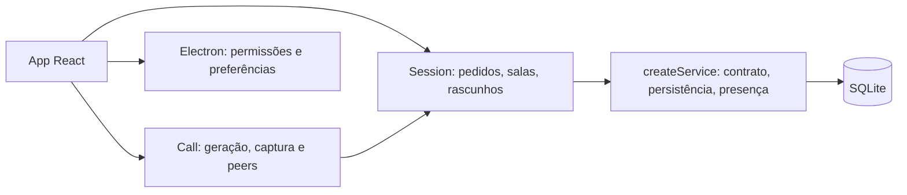

# Estabilização: design

**Spec:** [spec.md](spec.md). **Status:** execução local autorizada pela instrução de continuidade autônoma. Baseline Git: `63810f4`. Não há autorização de publicação ou operação pública.

## Architecture Overview

Manter Electron/React, o serviço existente e SQLite/WebRTC em malha. Cada captura pertence a uma geração de chamada; cada pedido terminal tem correlação e prazo; cada envio fixa sala e operação antes de sair do cliente. Fechar uma geração é definitivo.

Alternativas avaliadas: (1) corrigir os controladores existentes e extrair apenas o contrato e o transporte de sessão, escolhido por limitar o diff e permitir testar as corridas; (2) adicionar biblioteca de máquina de estados, descartado por dependência e migração desnecessárias; (3) reescrever cliente/servidor em camadas genéricas, descartado por ampliar R22 além do escopo. Nenhuma alternativa exige SFU, autenticação ou novo banco.

## Code Reuse Analysis

Preservar layout, elementos React, três transceivers por peer, factory createService, statements parametrizados, WAL, heartbeat, preload restrito e scripts Playwright. Usar node:test existente, sem framework de estado, schema ou testes adicional. As sondagens de review continuam intocadas como evidência histórica.

## Components

- `shared/protocol.js`: versão 1, limites e validadores explícitos de eventos/configuração. Funções puras reutilizadas por cliente e servidor. Sem sistema genérico de schemas.
- `src/rtc.js`: manter Call; geração crescente, aquisição exclusiva, captura provisória até admissão, descarte tardio e transação de publicação de tela. Falha de remoção fecha o peer afetado; não a chamada inteira.
- `server/service.js`: manter factory; handlers pequenos com respostas correlacionadas, idempotência persistida, cotas que não bloqueiam término, sockets com dono e close idempotente com deadline.
- `server/index.js`: validar ambiente antes de abrir recursos e centralizar bootstrap/encerramento. HMR tem consumidor explícito.
- `src/session.js`: controlar conexão, requests, prazo por fase e geração; conservar rascunhos/outbox por servidor e sala durante a execução. React recebe estado e ações. Recuperação manual.
- `src/main.jsx`: conectar Session e Call; admissão pendente cancelável, composer bloqueado durante troca, falhas de envio recuperáveis, modal/foco e leitura coerentes. CSS muda somente nos contrastes identificados.
- `electron/main.js` e preload: preferências sob userData, host único por perfil, origem/frame principal e tipo de mídia verificados em permissões/IPC; seletor cancelável e áudio bloqueado fora da chamada.
- Scripts de diagnóstico: teardown independente por recurso, flags explícitas e modo source sem manifesto. Não reutilizar dados pessoais nos ensaios.

## Data Models

Eventos de cliente: `v`, `type`, `requestId` nas operações confirmáveis; `room` na navegação/envio; `operationId` estável no envio; `callId` e `generation` na admissão. Media, signal e leave carregam callId; signal também identifica a geração de destino. Respostas terminais repetem requestId e resultado/código. Presença inclui callId vigente. Receptor descarta contexto obsoleto antes de aplicar estado.

Mensagens novas preservam id, room, author, text e created, acrescentando authorId e operationId únicos. Migrar de forma aditiva e transacional; dados legados continuam legíveis. A ordenação usa sequência de inserção e índice compatível com a seleção dos últimos 200. Reenvio da mesma operação/sala/texto retorna a mensagem original; conflito não modifica dados. Confirmação ocorre após commit, separada de broadcast.

Configuração valida PORT, lista ICE e limites da spec. Sem credenciais de produção, migração destrutiva ou expiração de registros. A1–A14 passam a padrões adotados sob a autonomia solicitada; continuam identificados como escolhas técnicas do agente, não respostas explícitas do usuário.

## Error Handling Strategy

Erros usam os códigos da spec e correlação, sem depender de texto traduzido. JSON/arrays inválidos são recusados. Toda etapa terminal invalida callbacks anteriores e libera recursos em finally. Logs registram somente fase/código/correlação/versão/runtime e classe de erro, nunca payload ou mensagem técnica que possa conter segredo. Falha depois do commit não reverte recibo.

## Risks & Concerns

| Concern | Location | Impact | Mitigation |
| --- | --- | --- | --- |
| Permissão resolve fora de ordem | src/rtc.js:8 | Captura antiga fica live | Geração e teste com promises controladas, inventário de todas as tracks |
| Substituição parcial | src/rtc.js:106 | Tela invisível ou estado divergente | Rollback total da tela e isolamento do peer com sender avariado |
| Estado de sala no socket | server/service.js:72 | Destino incorreto | Sala imutável no envio e validação no servidor |
| Escrita e broadcast no mesmo catch | server/service.js:76 | Reenvio duplica commit | Recibo persistido e fase de entrega independente |
| Upgrade sem dono | server/service.js:42 | Processo não termina | Registrar consumidores e sockets, recusa explícita e deadline |
| App concentra transporte e UI | src/main.jsx:19 | Callbacks antigos afetam sessão nova | Extrair somente Session, sem remodelar todo o layout |
| Banco existente | server/service.js:11 | Perda em alteração de schema | Migração aditiva transacional e teste com cópia legada |
| Ausência de autenticação | server/service.js:51 | Não há salas privadas | Manter C1 e bloqueadores R08/R09 explícitos |
| Captura física não disponível para aprovação automática | review/REVISAO_COMPLETA.md:382 | Falsa conclusão sobre ruído/qualidade | Registrar limite de evidência e não declarar resolução física |

## Tech Decisions

Sem dependências novas. Sem reorganização geral. O protocolo v1 quebra intencionalmente compatibilidade com o protocolo implícito da 0.1.1; os dois lados do aplicativo são atualizados juntos, e cliente antigo recebe incompatibilidade explícita. Nada é publicado automaticamente.
