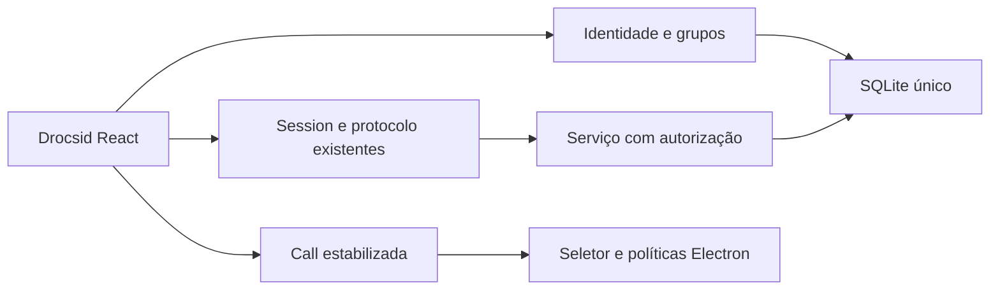

# Drocsid Integration Design

**Spec:** [spec.md](spec.md). **Status:** decisões técnicas delegadas pelo usuário em context.md.

## Architecture Overview

Abordagem escolhida: adaptar identidade/grupos ao serviço SQLite e à interface do Conversa. Mantém as transações e os controles MEDIA já testados. A alternativa PostgreSQL também entregaria o mesmo produto, mas exigiria migrar o banco legado, substituir os testes de persistência e operar outro processo antes de validar a integração. Essa infraestrutura pertence à entrega AWS; não é necessária para o protótipo de um processo e24conexões. Não manter dois bancos ativos ou dois aplicativos.

## Code Reuse Analysis

| Component | Existing owner | Integration |
| --- | --- | --- |
| Captura/RTC | src/rtc.js | Converter para TS preservando controle por tentativa/operação, rollback e deadlines. |
| Sessão/mensagens | src/session.js | Manter protocolo2, rascunhos e recibos; acrescentar autenticação e entrada em salas autorizadas. |
| Serviço | server/service.js | Autorizar antes de consultar histórico, dedupe, presença ou encaminhar sinais. Conexão segue com ID próprio; autoria autenticada usa ID estável da conta. |
| Identidade/grupos upstream | apps/server/src/auth.ts, guilds.ts e db.ts | Reaproveitar username, hashing/validação, associação e autorização; adaptar SQL e fortalecer expiração, revogação, rate limit e convites. |
| Host/preload | electron/main.js, policy.js e preload.cjs | Preservar UI local, frame/origem, negação de câmera, callback único, sandbox e contextIsolation. |
| Build/checkers | scripts e tests existentes | Manter resultados e comparar JS emitido ao ASAR; marca nova nos controles/artefatos. |

## Components

Identidade é proprietária de contas, sessões, tickets e grupos. Usa o mesmo DatabaseSync já aberto pelo serviço e não fecha o banco. Tabelas novas têm migração própria e transacional; o schema legado e seu user_version continuam validados. Uma tabela group_rooms associa as salas existentes a grupos sem atribuir salas antigas a contas recém-criadas.

O serviço só habilita convidados com uma opção explícita de confiança local e endereço de loopback. O host embutido usa essa opção e segue ouvindo somente127.0.0.1. O servidor separado exige contas por padrão. Endpoints privados validam Bearer; o renderer mantém token apenas em memória. POST autenticado fornece ticket WS de uso único, prazo30s, consumido antes do upgrade. Nenhuma sessão durável é enviada em URL. CORS aceita a UI local confiável e a própria origem, sem credenciais de cookie ou wildcard.

Senhas usam scrypt assíncrono N131072/r8/p1, sal16bytes, hash64bytes e limite de duas derivações concorrentes; falha de login é genérica e limitada por IP e username. Sessões aleatórias32bytes são persistidas somente por SHA256; expiram em24h ou30min de inatividade e logout revoga suas conexões. Validação/expiração não depende da UI. Convites têm32bytes aleatórios, hash, uso único, prazo24h e dono responsável; consumo/membership são atômicos. Conta só conhece grupos/salas de que participa.

A interface mantém o layout e os controles do Conversa. Recebe controles de cadastro/login/logout e grupos/criação/convite. O modo de teste local fica visivelmente distinto do login de conta. A UI não decide autorização. Ao mudar sala ou grupo, a chamada termina pelo caminho existente. Dados legados continuam somente no contexto local de confiança, sem atribuição de autoria nem exposição automática a contas.

## TypeScript and runtime

Converter fontes próprias a ts/tsx/mts/cts, mantendo bundles e relatórios históricos. Configurações separam DOM, Node, Electron/preload e instrumentação de testes. Strict é obrigatório; entradas externas são unknown com validação de runtime. Injeções de mídia usam contratos das operações realmente consumidas, alcançáveis pelos doubles atuais, sem casts amplos para browser APIs.

O compilador emite JS nos caminhos de runtime já usados pelos checkers, ignorados pelo Git depois da conversão. Isso mantém imports, raiz do app, serviço e preload estáveis sem uma segunda implementação. Vite constrói TSX; build e test incluem emissão e typecheck. Os scripts/testes próprios também recebem fontes TS e emissão correspondente. O checker continua comparando bytes dos arquivos emitidos, nunca fonte TS com JS de ASAR. A marca Drocsid não muda o diretório userData legado por acidente; perfis de teste explícitos continuam isolados.

## Risks & Concerns

| Concern | Location | Mitigation |
| --- | --- | --- |
| Aquisição tardia e concorrente vaza captura no upstream | apps/web/src/call.ts | Não substituir Call; manter testes MEDIA e sensor. |
| Primeira tela é escolhida automaticamente no upstream | apps/desktop/main.js | Conservar seletor explícito e bridge do Conversa. |
| Sessões sem expiração e convites permanentes no upstream | auth.ts, db.ts, guilds.ts | Tokens/tickets/TTL/revogação e testes negativos na identidade adaptada. |
| Dedupe legado aceita operação por outro convidado | server/service.js | Vincular recibo à identidade autenticada, validar autorização antes de recuperar registro. Modo legado fica local. |
| Conflitos add/add em manifests | Raiz | Merge real com ambos os pais, união de ignores e lock regenerado pelo npm; sem colar locks. |
| Mudança de marca altera userData e expectativas | Electron/package/checkers | Preservar caminho legado, atualizar apenas valores de marca exigidos pelo novo requisito. |
| TS por renomeação ou supressões não prova tipos | Fontes próprias | Strict, inventário completo, nenhum any/ts-ignore/ts-nocheck para esconder falhas. |
| Critérios antigos não certificam a nova candidata | Specs e pacote | Rerodar gates; preservar113 ACs como histórico e registrar novo commit/hash. T9 permanece física pendente. |

## Validation Strategy

Baseline94 preservada, ampliada com identidade, isolamento e UI. Cada proprietário inclui testes do resultado, limites e falhas. Gates de runtime, browser/Electron e pacote são sequenciais. Segurança inclui cruzamento de grupos, IDOR, ticket repetido/expirado, força bruta, dados/logs e dependências. Após provas, Verifier fresco da feature MERGE e sensores por asserção; nenhuma aprovação STAB/MEDIA é transferida por nome. Sem captura visual vinculante; não há screens sub-agent aplicável.
