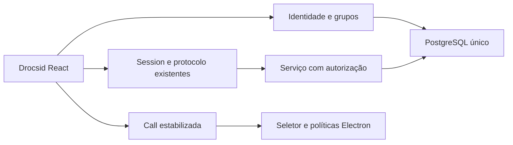

# Drocsid Integration Design

**Spec:** [spec.md](spec.md). **Status:** decisões técnicas delegadas pelo usuário em context.md.

## Architecture Overview

Abordagem escolhida após a resposta “Prefiro postgresql”: adaptar a persistência e identidade/grupos ao PostgreSQL e manter a interface, serviço e controles MEDIA do Conversa. AD-003 substitui AD-002. A alternativa SQLite foi recusada pelo usuário; manter dois bancos ativos duplicaria transações e autorização. O aplicativo Electron é cliente da API; credenciais PostgreSQL pertencem somente ao serviço. O deploy AWS continua fora do escopo e presença/sinalização continuam de um processo, sem promessa de escala horizontal.

## Code Reuse Analysis

| Component | Existing owner | Integration |
| --- | --- | --- |
| Captura/RTC | src/rtc.js | Converter para TS preservando controle por tentativa/operação, rollback e deadlines. |
| Sessão/mensagens | src/session.js | Manter protocolo2, rascunhos e recibos; acrescentar autenticação e entrada em salas autorizadas. |
| Serviço | server/service.js | Autorizar antes de consultar histórico, dedupe, presença ou encaminhar sinais. Conexão segue com ID próprio; autoria autenticada usa ID estável da conta. |
| Identidade/grupos upstream | apps/server/src/auth.ts, guilds.ts e db.ts | Reaproveitar username, hashing/validação, associação e autorização; adaptar SQL e fortalecer expiração, revogação, rate limit e convites. |
| Host/preload | electron/main.js, policy.js e preload.cjs | Preservar UI local, frame/origem, negação de câmera, callback único, sandbox e contextIsolation. |
| Build/checkers | scripts e tests existentes | Manter resultados e comparar JS emitido ao ASAR; marca nova nos controles/artefatos. |

## Components

Persistência em `server/database.ts` é proprietária do pool `pg`, migrações versionadas/checksum e transações. Usa schema próprio `drocsid` e SQL parametrizado. Migrações obtêm lock advisory transacional; versão futura/checksum divergente falham sem sobrescrever. DDL e registro de versão pertencem à mesma transação. Consultas de domínio validam os resultados externos antes de expor os tipos do protocolo. IDs continuam strings; datas/sequence continuam números inteiros seguros no contrato, recusando dados fora desse limite. O pool tem limites de conexão, aquisição, statement/lock e idle-in-transaction. Cada pool usa application_name aleatório; no shutdown com trabalho ativo, uma conexão de controle temporária encerra somente suas sessões e aguarda confirmação, sem matar sessões de outra instância.

Identidade é proprietária de contas, sessões, tickets e grupos no mesmo pool; não fecha o banco. Uma tabela group_rooms associa salas novas a grupos sem atribuir salas antigas a contas recém-criadas. Migração de dados do PostgreSQL público de uma instalação upstream não foi solicitada nem fornecida; o schema `public` é preservado, sem reutilização implícita de tabelas incompatíveis.

O importador `scripts/import-sqlite.mts` abre SQLite somente em leitura e valida sua versão/schema antes de escrever. Importa salas/mensagens/recibos preservando IDs, autoria, datas e sequence (rowid na versão antiga), em uma transação com lock de escrita e registro de importação. Repetição idêntica é idempotente; colisão com dado diferente aborta a transação. Nenhum usuário de conta é inferido a partir de nomes/IDs de convidados. SQLite não é fallback em execução normal. A cópia original permanece disponível para reversão operacional explícita; não há dual-write.

O serviço só habilita convidados com uma opção explícita de confiança local e endereço de loopback. O servidor separado exige contas por padrão. O cliente desktop serve apenas sua UI local se não estiver configurado explicitamente como host com DATABASE_URL; abre o formulário de endereço do servidor, sem iniciar PostgreSQL ou fallback SQLite. O modo host de desenvolvimento continua limitado a127.0.0.1. Endpoints privados validam Bearer; o renderer mantém token apenas em memória. POST autenticado fornece ticket WS de uso único, prazo30s, consumido antes do upgrade. Nenhuma sessão durável é enviada em URL. CORS aceita a UI local confiável e a própria origem, sem credenciais de cookie ou wildcard.

DATABASE_URL deve ser explícita, sem senha conhecida como padrão. Loopback pode usar conexão sem TLS somente no desenvolvimento isolado. Host remoto exige verificação de certificado e nome; configurar CA por caminho do servidor e recusar sslmode/rejectUnauthorized que contornem a validação. URLs com senha nunca aparecem em erros/logs, preferências, bridge ou distribuição do cliente. Docker Compose usa segredo fornecido pelo operador e porta restrita ao loopback; não é deploy de produção. Ensaios usam cluster PostgreSQL real temporário, credenciais aleatórias, SCRAM e listener loopback; falta de binários produz falha acionável, não skip.

Senhas usam scrypt assíncrono N131072/r8/p1, sal16bytes, hash64bytes e limite de duas derivações concorrentes; falha de login é genérica e limitada por IP e username. Sessões aleatórias32bytes são persistidas somente por SHA256; expiram em24h ou30min de inatividade e logout revoga suas conexões. Validação/expiração não depende da UI. Convites têm32bytes aleatórios, hash, uso único, prazo24h e dono responsável; consumo/membership são atômicos. Conta só conhece grupos/salas de que participa.

A interface mantém o layout e os controles do Conversa. Recebe controles de cadastro/login/logout e grupos/criação/convite. O modo de teste local fica visivelmente distinto do login de conta. A UI não decide autorização. Ao mudar sala ou grupo, a chamada termina pelo caminho existente. Dados legados continuam somente no contexto local de confiança, sem atribuição de autoria nem exposição automática a contas.

## TypeScript and runtime

Converter fontes próprias a ts/tsx/mts/cts, mantendo bundles e relatórios históricos. Configurações separam DOM, Node, Electron/preload e instrumentação de testes. Strict é obrigatório; entradas externas são unknown com validação de runtime. Injeções de mídia usam contratos das operações realmente consumidas, alcançáveis pelos doubles atuais, sem casts amplos para browser APIs. `createBrowserCall` fornece as dependências nativas à mesma Call e verifica sua compatibilidade em strict; o construtor de domínio recebe injeções explícitas. Tokens de timer são opacos ao controlador e voltam ao mesmo relógio que os criou.

O compilador emite JS nos caminhos de runtime já usados pelos checkers, ignorados pelo Git depois da conversão. Isso mantém imports, raiz do app, serviço e preload estáveis sem uma segunda implementação. Vite constrói TSX; build e test incluem emissão e typecheck. Os scripts/testes próprios também recebem fontes TS e emissão correspondente. O checker continua comparando bytes dos arquivos emitidos, nunca fonte TS com JS de ASAR. A marca Drocsid não muda o diretório userData legado por acidente; perfis de teste explícitos continuam isolados.

## Risks & Concerns

| Concern | Location | Mitigation |
| --- | --- | --- |
| Aquisição tardia e concorrente vaza captura no upstream | apps/web/src/call.ts | Não substituir Call; manter testes MEDIA e sensor. |
| Primeira tela é escolhida automaticamente no upstream | apps/desktop/main.js | Conservar seletor explícito e bridge do Conversa. |
| Sessões sem expiração e convites permanentes no upstream | auth.ts, db.ts, guilds.ts | Tokens/tickets/TTL/revogação e testes negativos na identidade adaptada. |
| Dedupe legado aceita operação por outro convidado | server/service.js | Vincular recibo à identidade autenticada, validar autorização antes de recuperar registro. Modo legado fica local. |
| Conflitos add/add em manifests | Raiz | Merge real com ambos os pais, união de ignores e lock regenerado pelo npm; sem colar locks. |
| Mudança de marca altera userData e expectativas | Electron/package/checkers | Preservar caminho legado, atualizar apenas valores de marca exigidos pelo novo requisito. |
| TS por renomeação ou supressões não prova tipos | Fontes próprias | Strict, inventário completo, nenhum any/ts-ignore/ts-nocheck para esconder falhas. |
| Critérios antigos não certificam a nova candidata | Specs e pacote | Rerodar gates; preservar113 ACs como histórico e registrar novo commit/hash. T9 permanece física pendente. |
| Consultas antes síncronas perdem ordenação após awaits | server/service.js | Preservar fila por cliente e revalidar contexto/fechamento após await; testar entrega, reconexão, saída e shutdown. |
| Recibo recuperado por outro autor ou disputa entre INSERTs | Persistência/mensagens | Índice único, transação, dono do recibo separado do ID de convidado legado; dois escritores reais e retorno idempotente autorizado. |
| Banco padrão upstream exposto com senha conhecida | docker-compose.yml e apps/server/src/db.ts | Configuração explícita, bind loopback, segredo fora do Git; teste remoto com verificação TLS, sem registrar URL. |
| Importação parcial ou destrutiva | Importador legado | SQLite somente leitura, transação PostgreSQL e comparação de todas as colunas, repetição e conflito com origem byte-idêntica. |

## Validation Strategy

Baseline94 preservada (95 após T1), ampliada com persistência PostgreSQL real, importação, identidade, isolamento e UI. Cada proprietário inclui testes do resultado, limites e falhas. Fixtures SQLite de compatibilidade permanecem como entrada de migração; os testes de resultado de mensagens/shutdown serão executados no novo proprietário PostgreSQL, preservando asserções. Nenhum teste emulado aprova transação/concorrência. Gates de runtime, browser/Electron e pacote são sequenciais. Segurança inclui cruzamento de grupos, IDOR, ticket repetido/expirado, força bruta, TLS, dados/logs e dependências. Após provas, Verifier fresco da feature MERGE e sensores por asserção; nenhuma aprovação STAB/MEDIA é transferida por nome. Sem captura visual vinculante; não há screens sub-agent aplicável.
