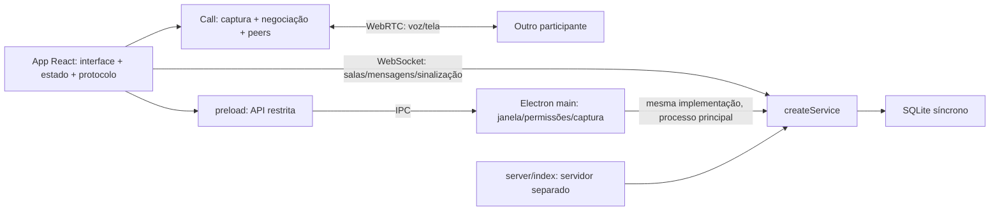

> **Contexto histórico, nota de 2026-10-25:** o corpo abaixo é o relatório original da referência preservada em `63810f4`. Suas afirmações de estado “atual”, ausência de Git, três testes e bloqueio Device Guard descrevem aquele momento, não o HEAD. As referências `file:line` do corpo usam essa referência imutável; consultar `git show 63810f4:caminho`. Os links de código servem somente para navegação ao arquivo, que pode ter mudado.
>
> A [spec STAB](../.specs/features/estabilizacao/spec.md) dá destinação aos 26 achados. O [BUILD posterior](../.specs/features/build-confiavel/validation.md) aprovou 11 critérios locais, 50 testes Node e 12 gates em `58be3ed`, sem certificar os 68 STAB ou 34 MEDIA. A [revisão de coerência](../docs/revisao-coerencia-documental.md) registra a situação documental reconciliada. Nenhum resultado ou medição do relatório original foi reescrito.
>
> [summary.json](summary.json), snapshots e probes continuam históricos. Seus 17 `confirmed` e exit 0 significam reprodução de defeito. O bloco de reprodução abaixo só é válido contra a referência histórica em ambiente isolado; rodá-lo no HEAD não reproduz automaticamente a revisão e pode sobrescrever evidências. Não foi executado nesta revisão documental.

**Revisão crítica do Conversa 0.1.1 — 24/10/2026**

**Parecer:** a implementação realiza os fluxos básicos de um protótipo, mas ainda não constitui uma base suficientemente estável para ampliar funcionalidades ou distribuir o serviço publicamente. Os principais problemas são de ciclo de vida de recursos, consistência de estado e definição do protocolo. Há defeitos reproduzíveis além das funcionalidades ainda ausentes, como cadastro e administração.

Foram registrados **26 achados: 9 P1, 14 P2 e 3 P3**. A contagem inclui defeitos, riscos estruturais e lacunas conhecidas que bloqueiam o uso como produto. Cada item informa sua natureza. Não foi demonstrado um P0, execução arbitrária de código, SQL injection ou XSS; isso não equivale a uma certificação de segurança.

P1 significa alta prioridade: captura, destino/confiabilidade de mensagens, saída da chamada, encerramento ou fronteira de acesso. P2 significa prioridade média: falha funcional, risco de operação ou deficiência estrutural que precisa de tratamento. P3 significa prioridade menor: manutenção, diagnóstico ou refinamento da experiência. As classificações consideram o objetivo de uso entre pessoas e computadores diferentes; as lacunas de autenticação e TURN são condicionadas a essa exposição.

**Escopo e método:** leitura de todos os arquivos de implementação próprios em `src`, `server`, `electron`, `scripts`, `tests` e `public`, além de configuração, manifesto, lockfile e documentação. O inventário inclui 18 arquivos de implementação/configuração, contando `package-lock.json`; documentação foi examinada separadamente. Dependências de terceiros foram verificadas por `npm audit`, sem auditoria linha a linha de `node_modules`. Binários de distribuição não foram descompilados. A revisão usa a versão presente no disco, pois a pasta não possui repositório Git próprio.

A implementação não foi alterada. Sondagens, cópia de leitura e build isolado foram gravados apenas em `review/`. Os hashes de entrada estão em [baseline.json](baseline.json), para comparação com [after.json](after.json). Os testes de mídia desta revisão usam dublês de APIs ou o dispositivo sintético do Chromium, com saída física de áudio silenciada.

**Verificações executadas:**

| Verificação | Resultado | Limite da evidência |
|---|---|---|
| `npm.cmd test` | 3 testes aprovados | Cobertura existente concentrada no servidor |
| `npm.cmd run build -- --outDir review/build` | Aprovado | Compilação do cliente; não é teste de distribuição |
| `npm.cmd audit --omit=dev --json` e `npm.cmd audit --json` | Nenhuma vulnerabilidade reportada | Consulta de dependências; não valida a lógica nem cobre toda a segurança do runtime Electron |
| `node review/rtc-probes.mjs` | 5 comportamentos problemáticos confirmados | APIs de mídia simuladas, sem captura física |
| `node review/server-probes.mjs` | 5 comportamentos confirmados | Servidor efêmero em memória e credenciais fictícias |
| `node review/ui-probes.mjs` | 7 comportamentos confirmados | Electron pelo código, proxy de teste e dados isolados |
| `node review/data-probes.mjs` | Plano SQL e contrastes calculados | Sem benchmark de carga ou auditoria completa de acessibilidade |

Resultados detalhados: [rtc-probes.json](rtc-probes.json), [server-probes.json](server-probes.json), [ui-probes.json](ui-probes.json), [data-probes.json](data-probes.json). As sondagens são reproduções de defeitos: exit code zero indica que o comportamento problemático esperado foi observado, não que a implementação passou em critérios de qualidade.

**Mapa dos achados:**

| ID | Prioridade | Natureza | Problema |
|---|---|---|---|
| R01 | P1 | Defeito reproduzido | Aquisições concorrentes/antigas de microfone perdem referências e escapam do encerramento |
| R02 | P1 | Defeito reproduzido na interface | Recusa de entrada na chamada deixa microfone ativo e sem controle de saída |
| R03 | P1 | Defeito reproduzido | Falhas parciais ao iniciar/parar tela deixam captura ou estado inconsistentes |
| R04 | P1 | Defeito reproduzido na interface | Mensagem enviada durante troca de sala vai para destino diferente do exibido |
| R05 | P1 | Defeito reproduzido na interface | Rejeição de mensagem descarta o texto digitado |
| R06 | P1 | Defeito reproduzido | Limite de eventos impede a saída da chamada |
| R07 | P1 | Defeito reproduzido | Upgrade desconhecido mantém socket aberto e bloqueia encerramento |
| R08 | P1 | Lacuna conhecida, confirmada | Nenhuma identidade/autorização protege salas e histórico |
| R09 | P1 | Exposição condicional confirmada | Credencial TURN configurada é entregue publicamente |
| R10 | P2 | Defeito reproduzido na interface | Timeout não encerra espera pelo `hello` após WebSocket abrir |
| R11 | P2 | Defeito reproduzido na interface | Preferências em localStorage não sobrevivem à mudança da porta local |
| R12 | P2 | Defeito reproduzido na interface | Convite colado no campo de servidor perde a sala |
| R13 | P2 | Deficiência de contrato | Eventos sem schema, códigos de erro ou identificação de tentativa/sessão |
| R14 | P2 | Deficiência de ciclo de vida | Negociação WebRTC falha sem recuperação ou limites suficientes |
| R15 | P2 | Risco estrutural | Servidor sem controle global de recursos, filas e retenção |
| R16 | P2 | Evidência SQL e análise estrutural | Índice desalinhado com histórico; acesso síncrono e modelo de persistência frágil |
| R17 | P2 | Endurecimento necessário | Permissões Electron são mais amplas que o caso de uso e validam a janela, não cada origem de frame |
| R18 | P2 | Deficiência de integração | Políticas de transporte/configuração divergem entre desktop e servidor |
| R19 | P2 | Defeito reproduzido e cálculo | Modal sem comportamento de teclado e textos com contraste insuficiente |
| R20 | P2 | Lacuna de verificação | Testes não cobrem as invariantes e não formam um processo de aprovação |
| R21 | P2 | Defeito por inspeção | Diagnóstico depende de build anterior e limpeza de testes pode ser pulada |
| R22 | P2 | Arquitetura e design | Responsabilidades e estados concentrados, sem contratos ou ferramentas de manutenção |
| R23 | P2 | Bloqueio operacional conhecido | Distribuição sem assinatura/validação da versão efetivamente entregue |
| R24 | P3 | Risco de manutenção | Staging cumulativo pode manter arquivos antigos e cresce sem política |
| R25 | P3 | Diagnóstico | Erros relevantes são descartados ou reduzidos a mensagens genéricas |
| R26 | P3 | Design de interação | Alguns estados e controles confundem o uso real |

**R01 (P1). Aquisições de microfone não pertencem a uma tentativa de chamada.**

Referências: [Call.join](C:/Code/conversa/src/rtc.js:8), [Call.toggleMicrophone](C:/Code/conversa/src/rtc.js:92), [Call.leave](C:/Code/conversa/src/rtc.js:121). Evidência: RTC-01, RTC-02 e RTC-04.

`join()` define `active = true` e aguarda a permissão. Se o usuário sair e iniciar outra tentativa antes de a primeira terminar, a primeira resposta encontra `active` verdadeiro e é aceita como atual. A resposta seguinte sobrescreve `this.microphone`. Na sondagem, `close()` encerrou o microfone novo e não chamou `stop()` na captura antiga. Duas chamadas simultâneas de `toggleMicrophone()` produzem a mesma perda de referência; o botão não possui bloqueio de aquisição pendente. `join()` também pede microfone mesmo depois de `close()` antes de detectar que a instância está encerrada.

O impacto é aquisição indevida para a tentativa atual e ausência de liberação determinística. A sondagem demonstra a lógica com tracks simuladas; não afirma que um microfone físico permaneceu ligado indefinidamente. Correção recomendada: uma máquina de estados com identificador monotônico de tentativa, aquisição exclusiva, rejeição imediata de operações em instância fechada e descarte de todo resultado que pertença a uma tentativa cancelada. Toda track adquirida deve ter proprietário até sua liberação, inclusive após `await`.

**R02 (P1). Recusa do servidor não desfaz a aquisição do microfone.**

Referências: [aquisição e pedido de entrada](C:/Code/conversa/src/rtc.js:8), [tratamento de erros](C:/Code/conversa/src/main.jsx:90), [joinCall](C:/Code/conversa/src/main.jsx:108). Evidência: UI-07.

O microfone é adquirido antes de `call-join`. Se o servidor responde com limite de ações ou outro erro, o cliente apenas desmarca `callPending`. A limpeza só acontece se o texto da mensagem contiver `chamada está cheia`. No teste, a interface voltou a oferecer “Entrar na chamada”, não exibiu “Encerrar chamada”, e a track sintética continuou `live`.

Isso é diferente de um usuário que entrou e escolheu falar: a admissão falhou e a interface perdeu o controle correspondente. O protocolo precisa de resposta estruturada à tentativa e uma compensação comum a qualquer rejeição/timeout. Pode-se admitir primeiro e adquirir depois, ou adquirir provisoriamente, mas a transação deve terminar liberando os recursos em todos os caminhos de falha.

**R03 (P1). Compartilhamento de tela não trata sucesso parcial nem garante finalização.**

Referências: [Call.shareScreen](C:/Code/conversa/src/rtc.js:106), [Call.stopScreen](C:/Code/conversa/src/rtc.js:115), [App.share](C:/Code/conversa/src/main.jsx:113). Evidência: RTC-03 e RTC-05.

Após capturar a tela, o método guarda o stream e tenta substituir tracks em todos os peers. Se um `replaceTrack()` rejeita, não há rollback, `stop()` da captura ou notificação da nova mídia. Alguns peers podem ter recebido a track antes da falha de outro. A interface pode continuar oferecendo “Compartilhar” mesmo com uma captura em andamento. Ao parar, as tracks são encerradas, mas uma rejeição em `Promise.all` pula `sharing=false` e `notify()`. O callback `onended` não trata a rejeição de `stopScreen()`, e a chamada de parar em `App.share` fica fora do `try/catch`.

São caminhos reais possíveis: [replaceTrack pode rejeitar](https://developer.mozilla.org/en-US/docs/Web/API/RTCRtpSender/replaceTrack), por exemplo quando a substituição exige renegociação. A finalização local e a atualização de estado devem ser garantidas em `finally`, independentemente da saúde de cada peer. O início deve definir uma política explícita para sucesso parcial, compensação e descarte da captura.

**R04 (P1). O destino da mensagem depende de um estado diferente do que o usuário está vendo.**

Referências: [changeRoom](C:/Code/conversa/src/main.jsx:101), [composer](C:/Code/conversa/src/main.jsx:144), [recebimento de mensagem](C:/Code/conversa/server/service.js:72). Evidência: UI-01.

O cliente pede a troca sem bloquear o composer. O servidor altera `client.room` antes de o cliente receber `joined`. A mensagem não carrega sala e é persistida na sala atual do socket. Com confirmação atrasada em 800 ms, a tela ainda mostrava `geral` quando o envio aconteceu, mas a mensagem ficou salva em `projetos`. O histórico foi recarregado para confirmar o destino persistido.

O risco envolve a intenção de destino da conversa, não apenas um atraso visual. Todo envio precisa carregar um destino imutável, validado no servidor, e a interface deve representar a transição de sala. Desabilitar o envio durante uma troca resolve parte da experiência; a validação do destino no protocolo também é necessária para evitar corridas e clientes incompatíveis.

**R05 (P1). O cliente apaga o texto antes de confirmar que a mensagem foi aceita.**

Referências: [send](C:/Code/conversa/src/main.jsx:46), [composer](C:/Code/conversa/src/main.jsx:144), [geração do ID no servidor](C:/Code/conversa/server/service.js:75). Evidência: UI-02.

`send()` pode não fazer nada se o socket estiver fechando, e o formulário chama `setDraft('')` incondicionalmente. Se o servidor rejeita o envio, há um toast, mas não há texto preservado, mensagem pendente ou reenvio. A reprodução com rejeição controlada deixou o campo vazio e nenhuma mensagem salva.

É necessário um ID de envio gerado no cliente, confirmação após persistência, deduplicação e um estado pendente/falho recuperável. Limpar o campo por envio otimista é aceitável se o texto permanecer na mensagem pendente; descartá-lo não é. Uma eventual falha de broadcast depois do commit também precisa ser distinguida de falha de persistência para não induzir duplicação no reenvio.

**R06 (P1). Controle de abuso interfere nas operações de encerramento.**

Referências: [budget de eventos](C:/Code/conversa/server/service.js:59), [call-leave](C:/Code/conversa/server/service.js:92). Evidência: SRV-04.

Todos os eventos dividem a mesma cota de 100 por 10 segundos. Ao consumi-la com sinalização, `call-leave` é rejeitado antes de chegar ao handler. O teste confirmou que outro participante continuou recebendo `inCall=true` para quem tentou sair. O cliente local encerra seus recursos, mas o servidor retém a vaga e a presença até outro evento permitido ou desconexão.

O teste usa sinalização sintética para atingir o limite; não foi medido que uma chamada normal de seis pessoas esgota a cota. Ainda assim, a rejeição de saída é um defeito confirmado. Encerramentos idempotentes precisam ser processados; mensagens, mídia, criação de salas e negociação devem ter limites próprios, com resposta estruturada e proteção global complementar.

**R07 (P1). Um Upgrade em caminho não reconhecido impede desligamento limpo.**

Referências: [upgrade](C:/Code/conversa/server/service.js:42), [service.close](C:/Code/conversa/server/service.js:118), [before-quit](C:/Code/conversa/electron/main.js:72). Evidência: SRV-05.

Para caminhos diferentes de `/ws`, o handler retorna sem responder nem destruir o socket. A sondagem abriu um Upgrade em `/unused-upgrade`: nenhum byte foi respondido e o encerramento não terminou até os sockets aceitos serem destruídos explicitamente pela instrumentação. No Electron, a saída do processo espera por `service.close()`, sem prazo máximo.

A integração precisa distinguir o Upgrade do HMR em desenvolvimento de conexões desconhecidas em produção. Deve existir um responsável por rejeitar/destruir os upgrades não atendidos, rastrear sockets e encerrar com prazo máximo. Também faltam idempotência de `close()` e tratamento uniforme para os dois sinais de encerramento. O comportamento é compatível com a responsabilidade do handler de [Upgrade HTTP do Node](https://nodejs.org/api/http.html#event-upgrade).

**R08 (P1). A fronteira atual de acesso é a capacidade de alcançar o socket.**

Referências: [hello](C:/Code/conversa/server/service.js:51), [join e histórico](C:/Code/conversa/server/service.js:63), [criação de sala](C:/Code/conversa/server/service.js:78), [origem](C:/Code/conversa/server/service.js:46). Evidência: SRV-01 e SRV-03.

Um cliente sem credenciais e sem `Origin` recebe a lista de salas, usa o nome de outra pessoa e lê o histórico de qualquer sala conhecida. Qualquer convidado pode criar salas. A ausência de contas foi documentada como limite do protótipo, mas é um bloqueador concreto para oferecer privacidade ou administração. O teste de mesma sala em `signal` é útil, porém só verifica presença atual; não autoriza o acesso ao grupo.

O CORS não substitui autenticação. A exceção de origem aceita qualquer porta de localhost, e clientes nativos podem omitir ou escolher `Origin`. O modelo precisa de identidade persistente, sessão, associação a grupo/sala e autorização para cada ação. A criação inicial de administrador deve ser explícita e não depender de um nome enviado pelo cliente. Nomes de exibição também não devem ser a identidade persistida de autoria.

**R09 (P1). Credenciais TURN estáticas passam a ser públicas quando configuradas.**

Referências: [api/config](C:/Code/conversa/server/service.js:29), [ICE_SERVERS](C:/Code/conversa/server/index.js:8). Evidência: SRV-02.

`/api/config` devolve integralmente `iceServers`, incluindo `username` e `credential`, sem autenticação. O padrão atual contém somente STUN; a reprodução configurou credenciais fictícias em memória. Portanto, não há alegação de vazamento de um segredo real existente. O defeito é condicional à configuração documentada de TURN com credencial fixa e à exposição do endpoint.

Essa configuração permite consumo não autorizado do relay e seus recursos. O desenho precisa de credenciais limitadas no tempo/uso, emitidas após autorização, proteção do endpoint e limites no relay. Esse item e R08 devem ser resolvidos antes de publicar uma infraestrutura TURN com custo ou recursos compartilhados.

**R10 (P2). O timeout protege a abertura do socket, mas não a negociação da aplicação.**

Referência: [enter/timeout](C:/Code/conversa/src/main.jsx:68). Evidência: UI-05.

O timer verifica somente `readyState !== WebSocket.OPEN`. Um servidor que aceita o WebSocket, mas não envia `hello`, deixa a tela em “Conectando…” com o botão desabilitado. O comportamento foi observado após 8,5 segundos, ultrapassando o timer de 8 segundos. É necessário um timeout para a resposta de protocolo, cancelamento da tentativa e limpeza de handlers/recursos. A mesma estrutura de prazo deve existir para entrar em sala e chamada.

**R11 (P2). A estratégia de persistência das preferências é incompatível com a origem local aleatória.**

Referências: [localStorage](C:/Code/conversa/src/main.jsx:21), [gravação de preferências](C:/Code/conversa/src/main.jsx:75), [porta aleatória](C:/Code/conversa/electron/main.js:20). Evidência: UI-04.

O servidor local usa uma porta aleatória a cada processo. O navegador separa o [localStorage por origem](https://developer.mozilla.org/en-US/docs/Web/API/Window/localStorage). Reiniciei o Electron com o mesmo diretório de usuário: a origem mudou de porta e o nome salvo desapareceu da entrada. Qualidade, áudio do sistema e demais preferências nem sequer são persistidos atualmente.

As preferências do desktop precisam de armazenamento estável sob `userData`, acessível por uma API restrita no preload, ou de um esquema/origem estável corretamente registrado. Fixar a porta sem definir concorrência e colisões apenas troca um problema por outro.

**R12 (P2). O fluxo de convite perde a seleção da sala no aplicativo desktop.**

Referências: [desiredRoom](C:/Code/conversa/src/main.jsx:43), [URL do servidor](C:/Code/conversa/src/main.jsx:59), [invite](C:/Code/conversa/src/main.jsx:123). Evidência: UI-03.

O convite inclui `?room=...`, mas, quando colado no campo “Servidor do grupo”, o código usa apenas `server.origin`. A sala inicial vem da URL da interface local, não do convite digitado. Um convite para `cafe` levou a `geral` no teste. Ainda não existe um protocolo de link para abrir o desktop.

O parser do convite deve separar endereço, identificador da sala e autorização, validar todos os campos e dar uma mensagem clara para convite inválido ou expirado. Abrir o link no navegador pode preservar a query; isso não corrige o fluxo de colar o convite no desktop.

**R13 (P2). O protocolo não possui contrato executável nem correlação entre operações.**

Referências: [roteamento dos eventos](C:/Code/conversa/server/service.js:61), [signal](C:/Code/conversa/server/service.js:99), [onmessage](C:/Code/conversa/src/main.jsx:69), [erro por texto](C:/Code/conversa/src/main.jsx:90). Evidência: SRV-04 confirma encaminhamento de candidato ICE com tipo incorreto; os demais pontos são inspeção de contrato.

A validação é parcial e espalhada. Arrays passam por `typeof object`; `signal.candidate`, `description.sdp` e outras formas não são validadas. O cliente faz `JSON.parse` e acessa listas/objetos sem verificar schema. Erros são apenas textos, e uma decisão de limpeza depende de uma expressão em português. Não há versão de protocolo, `requestId`, `callId` ou identificação da tentativa de conexão. Apenas `onclose` verifica se o socket ainda é o atual; os outros callbacks não possuem a mesma proteção.

Consequências prováveis são estado alterado por respostas tardias, quebra ao alterar uma mensagem de erro e falhas pouco diagnosticáveis entre versões. Não foi demonstrada exploração remota de código nem uma corrida de socket antigo nesta revisão. Recomenda-se um módulo compartilhado de schemas, união explícita de eventos, códigos estáveis, IDs de correlação e descarte de eventos fora da geração/sala/chamada vigente.

**R14 (P2). O ciclo WebRTC representa o caminho inicial, mas não a recuperação.**

Referências: [peer](C:/Code/conversa/src/rtc.js:19), [sync](C:/Code/conversa/src/rtc.js:51), [signal](C:/Code/conversa/src/rtc.js:72).

A eleição de um ofertante por comparação de IDs evita uma colisão no fluxo inicial controlado. Entretanto, `offered` é marcado antes de a oferta terminar e não é restaurado em erro. `failed` apenas exibe aviso. Não há prazo para um peer que permaneça em `new`/`connecting`, tentativa de recuperação, ICE restart, renovação de credenciais, reinício de sessão nem descarte por tempo da fila de candidatos que espera descrição remota. A interpretação das três posições dos transceivers também depende de um contrato não validado com o remetente.

São limitações confirmadas por inspeção, sem simulação de NAT ou queda de rede física nesta revisão. O estado de presença `inCall` significa que o servidor admitiu o participante; não significa que sua mídia está conectada. Uma máquina de estados de conexão precisa separar admissão, negociação, mídia pronta, reconexão e término. Uma eventual adoção de SDK/SFU deve ser avaliada após definir essas invariantes e não dispensa correções de captura ou mensagens.

**R15 (P2). Os limites atuais não controlam o consumo total do serviço.**

Referências: [clients e send](C:/Code/conversa/server/service.js:35), [broadcast](C:/Code/conversa/server/service.js:37), [limite por conexão](C:/Code/conversa/server/service.js:59), [salas](C:/Code/conversa/server/service.js:81).

`maxPayload` é uma proteção útil para entrada. Porém, não há limite de conexões totais, conexões por origem/usuário, observadores por sala, `bufferedAmount` de saída, tamanho do banco ou retenção de mensagens. Uma nova conexão recebe uma nova cota. Repetir `join` faz leitura e envio do histórico; a presença percorre todos os clientes e gera múltiplos broadcasts. O teto de 100 salas pode ser consumido por qualquer convidado e não existe exclusão administrativa.

São riscos de operação, não uma afirmação de indisponibilidade medida sob carga. O alvo de seis usuários em chamada não limita o total de clientes conectados ou escrevendo. Recomenda-se limites globais e por identidade, backpressure, fila máxima por socket, admissão de conexões e política de armazenamento. A complexidade e a capacidade real precisam de benchmark com uma carga definida.

**R16 (P2). A persistência funciona no caso simples, mas faltam decisões de escala e integridade do modelo.**

Referências: [schema/índice](C:/Code/conversa/server/service.js:11), [consulta de histórico](C:/Code/conversa/server/service.js:23), [insert/broadcast](C:/Code/conversa/server/service.js:75). Evidência: `data-probes.json`.

O índice é `(room, created)`, enquanto a consulta ordena por `rowid`. `EXPLAIN QUERY PLAN` mostrou busca no índice seguida de ordenação temporária, inclusive antes do limite de 200. O limite de retorno não garante que só 200 linhas participem do trabalho. Há uma segunda ordenação para apresentar a página em ordem crescente. Não houve medição de lentidão em uma base grande.

`DatabaseSync` executa na mesma thread do servidor e, no desktop, no processo principal Electron. I/O ou consultas demoradas competem com atendimento HTTP/WS e IPC. O timeout SQLite observado é zero; processos desktop separados podem acessar o mesmo banco porque não existe controle de instância única. Isso cria risco de `SQLITE_BUSY`, mas contenda entre processos não foi reproduzida nesta revisão.

O banco possui `NOT NULL` e chave primária para mensagens, mas não tem migrações versionadas, identidade persistente de autor, modelo de membros ou constraints relacionais entre salas e mensagens. O ordenamento por sequência é uma escolha válida; deve ser explícito e alinhado com índice e paginação. SQLite pode continuar atendendo a uma implantação pequena. Não há evidência aqui de que trocar de banco seja a primeira correção necessária.

**R17 (P2). A política de permissões Electron está mais ampla que o uso atual.**

Referências: [trusted](C:/Code/conversa/electron/main.js:11), [permissões](C:/Code/conversa/electron/main.js:23), [IPC](C:/Code/conversa/electron/main.js:36), [preload](C:/Code/conversa/electron/preload.cjs:2).

O projeto usa corretamente sandbox, isolamento de contexto, `nodeIntegration=false`, bloqueio de novas janelas e uma API pequena no preload. A seleção de tela verifica o ID da janela e uma fonte previamente inventariada. Esses são pontos positivos.

O endurecimento necessário está na granularidade: a permissão `media` é aprovada sem distinguir áudio de vídeo, e `trusted()` considera a URL principal do `webContents`, sem verificar `requestingOrigin`, `securityOrigin` ou `senderFrame` específico. O código atual não contém iframe remoto e sua CSP restringe frames por padrão; por isso não foi comprovado um acesso indevido por frame. O risco deve ser fechado antes de introduzir conteúdo externo, anexos ou novas integrações. O [guia de segurança do Electron](https://www.electronjs.org/docs/latest/tutorial/security) recomenda verificar o remetente das mensagens IPC. Preferir permissão de microfone estrita e validar origem/frame nas operações privilegiadas.

**R18 (P2). Configuração, segurança de transporte e bootstrap não têm uma política única.**

Referências: [cliente aceita HTTP/HTTPS](C:/Code/conversa/src/main.jsx:59), [configuração do servidor](C:/Code/conversa/server/index.js:8), [CSP do desktop](C:/Code/conversa/electron/main.js:14), [serviço local](C:/Code/conversa/electron/main.js:13).

O desktop cria o serviço sem ler `ICE_SERVERS`; o servidor separado lê essa variável. A validação externa de ICE apenas confirma que o valor é array, sem validar cada servidor. O cliente confia no JSON recebido e permite HTTP/WS para qualquer destino. Isso é útil para desenvolvimento em LAN, mas não define uma política segura para contas e sessões futuras. A CSP existe no serviço que entrega a interface desktop, mas não no bootstrap separado; a configuração de proxy/TLS fica fora do projeto.

`PORT` não é validado e os `listen()` não têm tratamento explícito de erro de inicialização. A API de saúde sempre responde `ok` e não expressa prontidão de persistência/mídia. Múltiplos processos desktop iniciam servidores locais distintos e não há `requestSingleInstanceLock`; isso é uma decisão de produto a explicitar, não um erro por si só. Recomenda-se configuração tipada compartilhada, perfis de desenvolvimento/produção, bootstrap com cleanup, readiness e decisão explícita sobre servidor local versus remoto.

**R19 (P2). A semântica modal não corresponde ao comportamento do teclado; há textos com contraste baixo.**

Referências: [Modal](C:/Code/conversa/src/main.jsx:16), [CSS](C:/Code/conversa/src/style.css:1). Evidência: UI-06 e cálculos em `data-probes.json`.

O modal declara `role=dialog` e `aria-modal`, mas não mantém o foco dentro dele, não torna o fundo inerte, não fecha com Escape e não restaura o foco explicitamente. A reprodução confirmou Escape sem efeito e saída do foco com Shift+Tab. Configurações também não movem foco inicial como o formulário de criação faz com `autoFocus`. O [padrão de modal da WAI](https://www.w3.org/WAI/ARIA/apg/patterns/dialog-modal/) exige o comportamento de teclado, não apenas atributos.

Foram calculados contrastes de 3,63:1 em `.composer-footer`, 4,00:1 em `.app-footer` e 4,35:1 no texto pequeno de `.space-header .eyebrow`, com fontes de 8 px. Para texto normal, a referência [WCAG AA é 4,5:1](https://www.w3.org/WAI/WCAG22/Understanding/contrast-minimum.html). Isso é uma amostragem de cores definidas, não um laudo de toda a tela. É necessário também validar zoom, seleção de fonte, foco visível e navegação com leitor de tela.

**R20 (P2). O conjunto de testes ainda não protege as principais invariantes.**

Referências: [suite de servidor](C:/Code/conversa/tests/server.test.js:36), [teste desktop](C:/Code/conversa/scripts/desktop-smoke.mjs:15), [npm test](C:/Code/conversa/package.json:13).

Os três testes existentes verificam aspectos úteis: persistência, troca de sala, entrega básica, sinalização para participante de outra sala e teto de chamada. Contudo, o teste que se chama “room isolation” não observa diretamente a ausência de uma mensagem em um cliente de outra sala. Não havia testes para `Call`, corridas de permissão, sucesso parcial de senders, envio durante troca, perda do rascunho, timeout de protocolo, acesso real a salas privadas ou falha de shutdown. Os três testes continuaram aprovados enquanto os defeitos reproduzidos estavam presentes.

O teste desktop é separado de `npm test`, depende de build prévio, percorre um fluxo linear e observa RTP e dimensões de vídeo. Isso prova tráfego e vídeo decodificado, mas não qualidade subjetiva, conteúdo correto do áudio ou ausência de eco. A própria revisão usa microfone sintético e não resolve a pendência do ruído físico. Recomenda-se uma pirâmide de testes do domínio/protocolo, integração do serviço, contratos e um grupo pequeno de fluxos desktop críticos, com execução automatizada e critérios explícitos de release.

**R21 (P2). Os diagnósticos não são independentes e podem deixar recursos de teste abertos.**

Referências: [startup-audio-check](C:/Code/conversa/scripts/startup-audio-check.mjs:7), [launch e finally](C:/Code/conversa/scripts/desktop-smoke.mjs:12), [cliente de teste](C:/Code/conversa/tests/server.test.js:14).

O diagnóstico de áudio lê `artifacts/build.json` incondicionalmente antes de decidir executar pelo código. Assim, mesmo com `CONVERSA_CHECK_SOURCE=1`, um checkout sem esse arquivo falha antes de iniciar. O manifesto guarda caminhos absolutos locais, que podem estar obsoletos em outra máquina. No smoke com servidor separado, `electron.launch()` ocorre antes do `try/finally`; se o Windows recusa o executável, o servidor de teste já iniciado não é fechado por esse `finally`. `desktop.close()` rejeitando também impede a próxima limpeza no mesmo bloco.

Os helpers WS dos testes não rejeitam a espera por eventos ao receber erro/close, e a lista de eventos não consumidos não é limitada. Variáveis booleanas são interpretadas pela presença de texto: `CONVERSA_TEST_EXTERNAL=0` ainda ativa o modo. Recomenda-se setup/teardown cobrindo inclusive falha de launch, interpretação de flags explícita, fixtures isoladas e diagnóstico de origem independente de artefatos de release. Estes problemas foram identificados por inspeção; não foi removido um manifesto real para reproduzir falha.

**R22 (P2). A concentração de responsabilidades dificulta manter consistência.**

Referências: [App](C:/Code/conversa/src/main.jsx:19), [Call](C:/Code/conversa/src/rtc.js:2), [createService](C:/Code/conversa/server/service.js:9), [configuração](C:/Code/conversa/package.json:9). Métricas: `code-stats.json`.

`App` reúne 22 estados, nove refs e quatro efeitos, além de formulário, transporte, ciclo de sessão, callbacks de chamada, convites, modais, lista, composer e tela. `session/currentSession`, `room/roomRef`, `inCall/Call.active/members.inCall` e os estados de mídia mantêm representações paralelas. O número de estados sozinho não é um defeito; as inconsistências R01–R06 mostram que suas transições não estão encapsuladas.

`Call` é a única classe do domínio de mídia e concentra aquisição, negociação, filas, envio de protocolo e publicação para a interface. `createService` mistura schema SQL, repositório, estado online, protocolo e transporte em uma closure. Quase toda a interface está em linhas JSX muito longas; cerca de 24 KB de CSS estão em duas linhas úteis, com regras repetidas e overrides ao final. Não há verificação de tipos, lint, formatador configurado, schemas compartilhados, pipeline CI ou histórico Git próprio nesta pasta.

Recomenda-se separar por responsabilidade e por invariantes: controle de sessão, transporte/protocolo, estado de sala/mensagens, controle de chamada, proprietário de capturas, repositório e handlers de servidor. Componentes de apresentação devem receber estado e ações, sem administrar o socket. Isso não pede criar uma classe para cada função nem adotar microserviços. Primeiro, preservar o comportamento com testes e definir contratos; depois, extrair módulos pequenos, sem duplicar estados.

**R23 (P2). Produzir o arquivo não garante uma distribuição verificável.**

Referências: [win/signAndEditExecutable](C:/Code/conversa/package.json:38), [build-windows](C:/Code/conversa/scripts/build-windows.mjs:7), [registro anterior de validação](C:/Code/conversa/artifacts/VALIDACAO.md).

A configuração desativa assinatura/edição, não exige assinatura e gera um portátil. Houve bloqueio Device Guard ao testar a 0.1.1; esta revisão não repetiu o lançamento desse binário nem modificou políticas do Windows. O script publica o arquivo e um manifesto após o builder, sem verificar abertura, assinatura, checksum ou equivalência com a versão aprovada nos testes. Executar o código e executar o portátil são verificações diferentes.

É necessário um processo de build limpo, identidade de publicação apropriada, instalação/abertura/atualização/removal testadas, manifesto com versão/hash/ambiente e promoção apenas de um artefato validado. [Assinatura no Electron](https://www.electronjs.org/docs/latest/tutorial/code-signing) é parte da distribuição; não promete que políticas corporativas aceitarão automaticamente o aplicativo. Credenciais/certificados e decisões de hospedagem não foram criados nem alterados nesta revisão.

**R24 (P3). O staging de empacotamento não é uma entrada limpa.**

Referências: [prepare-electron](C:/Code/conversa/scripts/prepare-electron.mjs:5), [build por timestamp](C:/Code/conversa/scripts/build-windows.mjs:7).

`cpSync` mescla uma distribuição Electron em `.packaging/electron` sem remover arquivos que deixaram de existir na origem. Após atualizar o runtime, pode haver arquivos antigos no staging. Cada build também retém outra árvore completa sem política de retenção. Os caminhos novos foram uma adaptação aos bloqueios observados de ASAR, mas não devem virar uma política de release sem limpeza controlada. O problema de obsolescência foi inferido pela semântica da cópia; esta revisão não trocou o runtime nem apagou staging.

Usar um staging identificado pela versão/hash do runtime, verificar seu inventário e definir retenção das saídas. A publicação do portátil deve ser atômica, para que falhas de cópia não deixem o nome final apontando a um arquivo parcial. Builds concorrentes precisam de serialização ou publicação separada.

**R25 (P3). A informação necessária para explicar falhas é descartada.**

Referências: [erro WS ignorado](C:/Code/conversa/server/service.js:54), [catch do servidor](C:/Code/conversa/server/service.js:107), [Media.play](C:/Code/conversa/src/main.jsx:13), [captura Electron](C:/Code/conversa/electron/main.js:34).

Erros de socket são ignorados; falhas de parse, SQL ou lógica viram a mesma mensagem; `.play()` rejeitando é silencioso; falhas de inventário de tela viram callback vazio, que pode parecer uma recusa/cancelamento normal. Não há correlação por tentativa/evento, registro de estado de mídia ou informação de ambiente suficiente para suporte. O catch do servidor ainda abrange tanto insert quanto broadcast, embora possam ter resultados distintos.

Introduzir logs estruturados e erros tipados, com IDs de correlação e fases da operação. Registrar causa técnica localmente e apresentar ação útil ao usuário. Proteger dados: logs não precisam de conteúdo de mensagem, tokens, senhas, thumbnails ou captura. Silenciar o teste sintético e bloquear playback na entrada são medidas úteis, mas não demonstram a causa do ruído relatado.

**R26 (P3). A apresentação ainda contém ambiguidades que afetam o uso.**

Referências: [statusText](C:/Code/conversa/src/main.jsx:132), [palco de tela](C:/Code/conversa/src/main.jsx:141), [chat/agrupamento](C:/Code/conversa/src/main.jsx:144), [scroll](C:/Code/conversa/src/main.jsx:51), [settings](C:/Code/conversa/src/main.jsx:149).

“Conectado à voz” deriva de presença, não de mídia conectada. Uma pessoa fora da chamada vê um bloco “AO VIVO” sem ter stream para reproduzir. Mensagens de pessoas distintas com o mesmo nome são agrupadas como um único autor. Toda mensagem força scroll para o fim, mesmo se a pessoa estiver lendo histórico. Preferências de qualidade só afetam a próxima captura, mas a interface não explica isso. Há um botão de espaço sem ação e versão visual fixa `v0.1`, que não identifica o patch atual. Trocar o canal de texto encerra a chamada porque o modelo usa uma única sala por cliente; isso precisa ser uma decisão explícita antes de aproximar a experiência do Discord.

Recomenda-se um estado de interface que represente conexão real e operação pendente, convite para assistir quando fora da chamada, autoria por ID, scroll condicionado à posição e controles com efeito explicado. Esses ajustes devem seguir as correções de consistência, e não mascará-las.

**Arquitetura atual e fronteiras de responsabilidade.**



Há dois modos de hospedagem: o processo Electron cria um serviço HTTP/WS local com banco em `userData`, enquanto `server/index` oferece o serviço separado com banco em `data/`. A mídia passa entre peers, com eventual relay TURN configurado, sem atravessar o servidor de mensagens. A implementação não separa contexto de grupo, sala de texto e chamada: um socket possui somente uma `room`. O processo principal é simultaneamente host de UI, backend, dono do banco e controlador privilegiado do desktop.

As fronteiras que deveriam ficar explícitas são: interface versus estado de domínio; socket versus sessão autenticada; sala de texto versus participação em chamada; aquisição de recursos versus publicação; persistência versus entrega; autorização versus presença; configuração local versus produção. A falta dessas fronteiras explica as corridas mais importantes, mesmo com pouco código.

**Inventário da classe `Call`.** Todos os seus métodos foram analisados; a tabela registra comportamento atual e dependências de correção.

| Método | Responsabilidade atual | Avaliação |
|---|---|---|
| `constructor` | Injeta callbacks/config e cria flags/Map | Injeção ajuda a testar; flags independentes não representam todas as fases, R01/R22 |
| `join` | Adquire microfone e pede admissão | Sem exclusão/cancelamento por tentativa ou confirmação, R01/R02 |
| `notify` | Publica muted/display para a UI | Simples, mas não garante notificação em caminhos de exceção, R03 |
| `peer` | Cria PC e três slots; conecta eventos | Sem timeout/recuperação; stream agrega áudio/vídeo/sistema, R14/R25 |
| `attachTracks` | Define direções e substitui três senders | Direção explícita é útil; operação pode ser parcial e requer transação, R03 |
| `publishStreams` | Expõe streams e connectionState | Dá visibilidade do PC, mas a UI não usa isso como fonte consistente de conexão, R26 |
| `sync` | Sincroniza peers com presença e elege ofertante | `offered` impede nova tentativa após erro; estado próprio ausente não encerra a captura, R02/R14 |
| `signal` | Serializa descrição/candidatos por peer | Fila por peer é positiva; faltam schema, geração e limites de pendência, R13/R14 |
| `toggleMicrophone` | Adquire ou habilita/desabilita track | Sem aquisição exclusiva nem recuperação de track encerrada externamente, R01/R14 |
| `shareScreen` | Captura e publica tela/áudio | Sem rollback de falha parcial, R03 |
| `stopScreen` | Encerra tracks e remove dos senders | Falhas podem pular notificação e metadata; callback assíncrono sem catch, R03 |
| `leave` | Para recursos conhecidos e fecha peers | Não cobre aquisições pendentes nem recursos que perderam referência, R01/R06 |
| `close` | Chama leave e marca closed | Não protege a entrada de novos métodos; precisa de semântica idempotente e final, R01 |

**Inventário das funções da interface e seus efeitos.**

| Função/efeito | Avaliação |
|---|---|
| `initials`, `colorFor`, `Avatar` | Helpers pequenos e determinísticos para dados válidos; nomes vindos da rede sem schema podem quebrá-los. Identidade visual por nome não substitui autoria por ID |
| `Media` | Reproduz stream corretamente no caminho básico; suprime falhas de play, não diagnostica autoplay/saída e não limpa `srcObject` explicitamente ao desmontar. O proprietário das tracks deve continuar sendo a chamada, não este componente compartilhado |
| `Modal` | Estrutura reutilizável; comportamento modal incompleto, R19 |
| `App` | Orquestra tudo e renderiza quase toda a tela, R22 |
| `notify` | Um toast substitui o anterior e desaparece; não é histórico nem estado persistente de falha, R25 |
| `send` | Não retorna resultado e descarta envio sem socket aberto, R05 |
| `enter` | Faz config, handshake, persistência e instala callbacks; falta contrato, cancelamento e prazos por fase, R10–R13 |
| `changeRoom` | Encerra chamada e pede sala; mantém composer ativo e apaga draft ao receber joined, R04/R26 |
| `leaveCall` | Força UI fora da chamada e chama leave sem confirmação, R06 |
| `joinCall` | Apenas trava o botão enquanto espera; não é uma transação de admissão/aquisição, R01/R02 |
| `share` | Início tem catch/finally; parada anterior ao try não tem, R03 |
| `disconnect` | Limpa parte do estado e fecha transporte; não centraliza geração/cleanup de toda a sessão, R13/R22 |
| `invite` | Copia endereço com query; não oferece fluxo desktop autorizado, R12 |
| Efeito de captura/unmount | Assina IPC e limpa ao desmontar; não cancela `enter` pendente nem protege resposta de fetch antiga |
| Efeito de scroll | Sempre rola para o fim, R26 |
| Efeito de playback | Bloqueia/libera saída conforme `inCall/deafened`; é uma defesa útil, não controle do ciclo de captura do microfone |
| Handler do composer | Sem destino/ack/pendência; perda e corrida confirmadas, R04/R05 |
| Handlers de criação/settings/captura | Estado local e callbacks diretos; criação pode ser submetida repetidamente sem request em voo; preferências não são duráveis, R11/R22 |

**Inventário do serviço e do desktop.**

| Unidade | Responsabilidade e avaliação |
|---|---|
| `createService` | Factory testável com banco/ICE injetáveis; concentra armazenamento, políticas e transporte, R22 |
| `send` / `broadcast` | Entrega somente a sockets OPEN; não há backpressure/ack nem tratamento por destinatário, R05/R15 |
| `members` / `presence` | Publicam estado atual por sala; presença não representa qualidade de mídia, R14/R26 |
| `error` | Mensagem livre sem código ou request, R13 |
| `isLocalOrigin` / upgrade | CORS e compatibilidade local; não são autenticação e há caminho sem dono de socket, R07/R08 |
| `hello` / `join` | Expõem lista/histórico e atualizam sala; precisam de sessão/autorização e resposta correlacionada, R04/R08 |
| `message` | Valida tamanho e usa statement parametrizado; falta identidade, destino e idempotência, R04/R05/R08 |
| `create-room` | Valida nome e limite total; qualquer convidado pode executar, R08/R15 |
| `call-join` / `call-leave` | Capacidade básica e presença; orçamento e ausência de transação prejudicam saída/admissão, R02/R06 |
| `media` / `signal` | Metadados são autodeclarados; verifica sala e participação antes de encaminhar, mas não contrato/sessão, R13 |
| heartbeat / close | Heartbeat ajuda com conexões mortas; shutdown incompleto para upgrades desconhecidos e sem deadline, R07 |
| `server/index` | Entrypoint simples e separado do core; falta validar e tratar bootstrap/config e harmonizar políticas, R18 |
| `trusted` / permission handlers | Origem principal é verificada; escopo de mídia/frame deve ser refinado, R17 |
| display request / `capture-select` | Seleção explícita e por ID é positiva; erros de inventário e cancelamento não são diferenciados, R25 |
| `playback-state` | API estreita; confia no bool da UI, não mantém estado de chamada no main. É barreira de reprodução, não autorização do servidor |
| `openWindow` | Sandbox, isolamento e bloqueio de popups são positivos; serviço/porta e armazenamento criam R11/R18 |
| menu / navigation | Navegação externa bloqueada; ferramentas de desenvolvimento e janela de teste estão na distribuição, uma decisão a revisar antes de release |
| `closed` / before-quit | Tenta cancelar seleções e fechar serviço; o encerramento herda R07. Falhas do callback não têm diagnóstico específico |
| preload | Expõe capacidades específicas sem liberar `ipcRenderer` genérico; bom ponto para preservar ao extrair módulos |

**Pontos a preservar.**

Os statements SQL usam parâmetros e o texto de mensagem é renderizado como texto React; os caminhos inspecionados não usam concatenação SQL de dados nem `dangerouslySetInnerHTML`. Há WAL, IDs de mensagem gerados no servidor, limite de tamanho, heartbeat e checagem de participação/sala antes de encaminhar sinalização. A factory de serviço e a injeção de callbacks da chamada permitiram os testes isolados. O desktop começa com reprodução bloqueada, usa contexto isolado e sandbox e solicita uma seleção de tela. O lockfile fixa a resolução de dependências. Essas escolhas são úteis, embora não resolvam autenticação, concorrência ou qualidade de mídia.

**Ordem de saneamento recomendada, antes de ampliar funcionalidades.**

1. Congelar esta referência em controle de versão e transformar as reproduções críticas em regressões com expectativa de comportamento correto. As sondagens atuais intencionalmente confirmam o defeito; não devem ser copiadas para CI como se aprovassem o produto.
2. Definir estados e proprietários de recursos. Toda captura deve ser encerrada em cancelamento, recusa, erro parcial, desconexão e saída; resultados tardios devem ser descartados por tentativa. Fechar R01–R03 antes de ampliar mídia.
3. Definir o protocolo compartilhado com `roomId`, `requestId`, `callId`, códigos de erro e respostas de admissão/commit. Fechar R04–R06 e R10/R13 sem depender de texto de toast.
4. Completar ownership dos sockets e shutdown com prazo máximo. Fechar R07 e cobrir seu caso no teste de integração.
5. Extrair as responsabilidades já definidas em módulos pequenos: transporte, sessão, sala/mensagens, chamada/captura, repositório e handlers. Formatar, adicionar lint e tipos/schemas; preservar as invariantes durante a extração.
6. Antes de exposição externa, implementar identidade/autorização e emissão segura de credenciais de mídia. Isso fecha R08/R09, com testes de acesso direto ao servidor, não apenas de esconder botões.
7. Estabelecer configuração estável, preferências, convite, acessibilidade e diagnóstico. Fechar R11/R12/R18/R19 e assegurar que a interface informa fases reais da conexão.
8. Executar testes entre computadores/redes diferentes, carga definida e aprovação da distribuição Windows. Só então decidir, com medidas, necessidade de SFU/SDK, banco diferente ou infraestrutura adicional.

As invariantes mínimas de aprovação são: nenhuma captura sem proprietário e controle visível; nenhum envio para sala diferente da intenção fixada; nenhuma perda silenciosa de texto; nenhuma saída bloqueada pela cota; nenhum histórico acessível sem autorização quando o produto oferecer privacidade; nenhum artefato declarado aprovado apenas porque compilou.

**Reprodução desta revisão.**

```powershell
cd C:\Code\conversa
npm.cmd test
npm.cmd run build -- --outDir review/build
node review/rtc-probes.mjs
node review/server-probes.mjs
node review/ui-probes.mjs
node review/data-probes.mjs
```

`ui-probes.mjs` requer a distribuição Electron de desenvolvimento instalada e abre janelas efêmeras com dados isolados. A saída de som fica silenciada. Os testes não fazem login no Discord, não usam dados do usuário, não exercitam microfone físico e não publicam nem hospedam o serviço. O teste de UI usa `dist/` da aplicação presente; nesta revisão seu bundle correspondeu ao build isolado gerado a partir do código atual.

**Limites e pendências de evidência.** O problema físico de som na abertura continua sem causa demonstrada. As falhas de captura simuladas não são apresentadas como essa causa. Não houve teste real entre redes, áudio de sistema real, desempenho prolongado com seis usuários, perda de energia do banco, restauração de backup ou nova aprovação do portátil no Windows. Também não houve testes com leitor de tela. Os riscos estáticos foram explicitamente separados das reproduções e as funções atuais foram examinadas sem introduzir uma migração de arquitetura ou novas funcionalidades.
